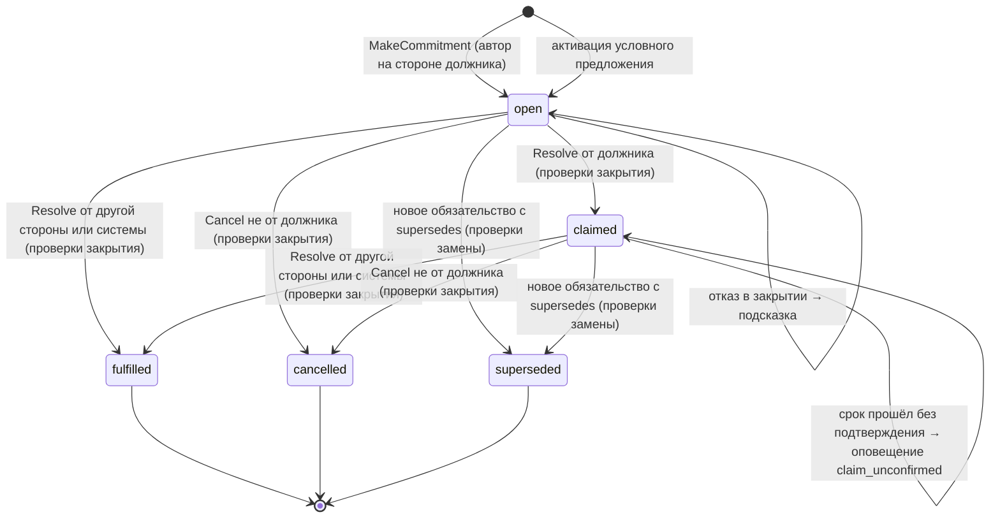

# 2. Описание предлагаемого метода

> **Статус: черновик для доработки автором.** Раздел описывает то, что
> реализовано в репозитории duebook на коммите `ce43f99`
> (пакет `src/duebook`). Метод зафиксирован: дальнейшие изменения возможны
> только через записи решений в `docs/decisions/`. Имена модулей, классов и
> функций даны моноширинным шрифтом, чтобы описание можно было сверить с
> кодом (соответствие подразделов модулям — в `README.md` этой папки).
> Числа экспериментов взяты из `docs/results.md` и помечены
> «[предварительные результаты, будут обновлены]»; глава с результатами
> будет написана отдельно.

## 2.1. Общая схема

Метод называется **структурированной событийной памятью** обращения. Его
главная идея — разделить две роли, которые в системах памяти LLM-агентов
обычно совмещены (раздел 1.4):

- **языковая модель предлагает.** Прочитав новое событие обращения, она
  формирует список предложений по изменению состояния: «зафиксировать
  факт», «зарегистрировать обязательство», «отметить выполнение» и т. п.;
- **детерминированный слой решает.** Чистая функция без часов, сети и
  модели проверяет каждое предложение по набору правил и либо применяет
  его, либо отклоняет с указанием причины.

Состояние обращения хранится в виде **карточки** (card). Карточка — это
свёртка потока событий:

$$C_i = \mathrm{apply}(C_{i-1},\ e_i,\ P_i), \qquad P_i = R(C_{i-1}, e_i, e^{\mathrm{prev}}_i), \qquad C_0 = \varnothing,$$

где $e_i$ — $i$-е событие обращения, $e^{\mathrm{prev}}_i$ — предшествующая
публичная реплика другой стороны (2.2), $R$ — извлекатель (языковая модель
и, для закрывающих предложений, верификатор), $P_i$ — его предложения,
$\mathrm{apply}$ — редьюсер (`duebook.reducer.apply`). Предложения $P_i$
сохраняются вместе с событием, включая вердикты верификатора и номер версии
правил, по которой событие было решено. Поэтому карточку на любой момент $k$
можно восстановить без повторного обращения к модели:
$C_k = \mathrm{fold}(\mathrm{apply}, \varnothing, ((e_1, P_1), \dots, (e_k, P_k)))$
(`reducer.replay`, `Store.replay`). Это делает карточку воспроизводимой,
проверяемой и сравнимой между прогонами. Подход наследует идею event
sourcing [20]: источник истины — журнал событий, текущее состояние —
производное от него.

Вокруг этого ядра построены:

- разрешение сроков, при котором модель не вычисляет даты (2.6);
- нормализация имён слотов фактов и множества значений для идентификаторов
  (2.7);
- проверка закрытия обязательств и верификатор как право вето (2.5.5–2.5.6);
- условные предложения как отдельный вид записи (2.5.7);
- жизненный цикл обязательства (2.8) и правила его передачи (2.9);
- вывод оповещений как функции от карточки и времени (2.10);
- журнал событий, снимок карточки и outbox оповещений в PostgreSQL (2.11);
- сводка для оператора, принимающего обращение (2.12);
- обработка сообщения, которое модель не смогла прочитать (2.13).

TODO (автор): вставить рисунок с архитектурой (вебхук → журнал событий →
процессор: извлечение, верификатор, редьюсер → снимок карточки и outbox →
планировщик и доставка; чтение карточки и сводки через API). Источник для
рисунка — таблица команд в корневом `README.md` (раздел «Running the
service»).

## 2.2. Входные данные: события обращения

Вход системы — упорядоченный поток событий одного обращения
(`duebook.events`). У каждого события есть идентификатор, идентификатор
обращения, порядковый номер `seq` внутри обращения (начиная с 1; он же ключ
идемпотентности) и время с часовым поясом. Реализованы три типа событий:

| Тип | Содержание |
|---|---|
| `MessagePosted` | автор (`Actor`), текст, признак публичности (внутренняя заметка клиенту не видна) |
| `AssigneeChanged` | прежний и новый ответственный оператор (любой из них может отсутствовать) |
| `StatusChanged` | прежний и новый статус обращения |

У автора сообщения есть **роль** (`customer`, `agent`, `bot`, `system`), из
которой выводится **сторона** (`Side`): клиент, компания (оператор и бот) или
система. Сторона «система» — это источник, не являющийся ничьим словом
(например, уведомление биллинга). Только такой источник наравне с
противоположной стороной может подтвердить выполнение обязательства (2.8).

Для публичного сообщения клиента или компании определена **предшествующая
реплика**: последнее публичное непустое сообщение другой стороны
(`events.other_side`, `Store.previous_turn`). Она нужна для коротких ответов
вроде «Ага, вижу», предмет которых назван только в вопросе собеседника
(2.5.6). Внутренние заметки и системные сообщения предшествующей репликой не
бывают.

События — это факты о helpdesk, а не их интерпретация. Всё, что система
«знает» об обращении, выводится из этого потока.

## 2.3. Модель данных карточки

Карточка (`duebook.card.Card`) — неизменяемое значение: редьюсер не
изменяет её, а возвращает новую. Из карточки ничего не удаляется: устаревший
факт сохраняет интервал действия и ссылку на то, что его заменило. Состав
карточки приведён в таблице 2.1.

**Таблица 2.1.** Сущности карточки

| Сущность | Поля | Назначение |
|---|---|---|
| `Source` (источник) | идентификатор и номер события, автор, сторона, **дословная цитата** | на чём основано любое утверждение карточки; у каждого убеждения есть источник |
| `Fact` (факт) | слот (например, `order.status`), значение, источник, начало действия `valid_from`, конец действия `valid_to` (пусто, пока факт текущий), `superseded_by` | сведения о деле; в слоте одно текущее значение на сторону, в слоте-идентификаторе — множество значений (2.7) |
| `Contradiction` (противоречие) | слот, пара фактов разных сторон, момент обнаружения, момент разрешения | стороны расходятся, и никто это не урегулировал |
| `Commitment` (обязательство) | должник (`Party`: оператор лично, компания, клиент), действие, источник, момент создания, срок (`Due`), состояние, ответственный, от кого унаследовано, моменты заявления и закрытия, источник закрытия, источник контекста закрытия, источник активации, `superseded_by`, отклонённые закрытия (`suggestions`), отметка о проверке заявления (`claim_checked`, решение 0006) | обещание как сущность с жизненным циклом |
| `Conditional` (условное предложение) | должник, действие, источник (всё предложение), формулировка условия, срок условия, состояние (ожидает / активировано / утратило силу), источник исхода, созданное обязательство, отклонённые исходы | «если не придёт до пятницы, вернём деньги»: пока условие не наступило, ничего не должно (2.5.7) |
| `Due` (срок) | момент (`Deadline`: время и точность — до минуты или до дня), структурное выражение срока (`DueExpr`), уровень уверенности, цитата срока | разрешённый срок и степень доверия к нему |
| `Suggestion` (подсказка) | вид закрытия (выполнено, отменено, заменено, активировано, утратило силу), источник, причина отказа, заменяющее обязательство | закрытие, которое редьюсер не допустил: обязательство осталось открытым, а оператор видит «возможно, выполнено по сообщению №N — подтвердите» |
| `Step` (шаг) | действие, источник, исход (ожидается / помогло / не помогло), источник исхода | что уже пробовали; неудачный шаг нельзя предлагать снова |
| `Question` (вопрос) | текст, источник, сторона, от которой ждут ответа, источник ответа | открытые вопросы |
| `Unread` (непрочитанное сообщение) | источник (всё сообщение), момент, текст ошибки | сообщение, которое модель так и не смогла прочитать; его должен проверить человек (2.13) |
| `Card` (карточка) | номер последнего учтённого события, ответственный и статус (с номерами установивших их событий), кортежи всех сущностей выше | всё, что система сейчас знает об обращении |

Отметим четыре свойства модели.

1. **Факт с интервалом действия.** Факт $f$ действует на интервале
   $[\mathit{valid\_from}_f, \mathit{valid\_to}_f)$; текущий — тот, у которого
   $\mathit{valid\_to}_f$ не задан. Пары «было — стало» восстанавливаются по
   ссылкам `superseded_by` (`Card.changed_facts`). Это модель
   действительного времени в смысле темпоральных баз данных [19]. Время
   транзакции в карточке не хранится, но восстанавливается по журналу
   (2.11).
2. **Должник отличается от ответственного.** Должник (`owner`) — тот, кто
   обещал: оператор лично (`agent`), компания (`company`) или клиент
   (`customer`). Ответственный (`responsible`) — оператор, который
   *сейчас* отвечает за обещание стороны компании. Ответственный может
   меняться при передаче обращения (2.9); должник не меняется никогда.
3. **Состояние обязательства хранит только то, что установлено событиями**
   (открыто, заявлено выполненным, выполнено, отменено, заменено).
   Статусы, зависящие от времени («скоро срок», «просрочено»), не хранятся,
   а вычисляются (2.8, 2.10).
4. **Отказ не теряется.** Отклонённое закрытие хранится на самом
   обязательстве как подсказка, а не выбрасывается: метод не угадывает, но и
   не прячет свидетельство от человека.

## 2.4. Правило обновления и извлечение предложений

### 2.4.1. Предложения

Извлекатель может сформулировать десять видов предложений
(`duebook.proposals`), перечисленных в таблице 2.2; одиннадцатый вид,
`Unreadable`, записывает не модель, а конвейер (2.13). Каждое предложение
несёт поле `quote` — дословный фрагмент сообщения, на котором оно основано.

**Таблица 2.2.** Виды предложений

| Предложение | Параметры (кроме цитаты) | Смысл |
|---|---|---|
| `AssertFact` | слот, значение, признак `change` | сообщение утверждает значение; `change` — говорящий сообщает, что значение *изменилось* («перевёл вас на тариф Про»), а не оспаривает чужое |
| `MakeCommitment` | должник, действие, структурный срок `due`, дословная фраза срока `due_quote`, `supersedes`, `target_quote`, вердикт | новое обещание; `supersedes` — оно заменяет прежнее (перенос срока) |
| `ResolveCommitment` | идентификатор обязательства, `target_quote`, `context_quote`, вердикт | кто-то говорит, что действие выполнено |
| `CancelCommitment` | идентификатор обязательства, `target_quote`, вердикт | обязательство больше не нужно |
| `MakeConditional` | должник, действие, формулировка условия, срок условия и его фраза | предложение, которое станет обязательством, только если условие наступит |
| `SettleConditional` | идентификатор предложения, наступило ли условие (`holds`), `target_quote` | сообщение говорит, наступило ли условие |
| `RecordStep` | действие, исход | предложен или опробован шаг решения |
| `SetStepOutcome` | идентификатор шага, исход | сообщён исход шага |
| `AskQuestion` | текст | вопрос, на который должна ответить другая сторона |
| `AnswerQuestion` | идентификатор вопроса | ответ на открытый вопрос |
| `Unreadable` | текст ошибки (цитата — всё сообщение) | ни одна попытка не смогла прочитать сообщение (2.13) |

Предложение, которое закрывает, отменяет или заменяет обязательство (а
также исход условного предложения), называет свою цель **дважды**:
идентификатором и `target_quote` — фрагментом, скопированным из исходной
формулировки цели. `context_quote` — фрагмент предшествующей реплики, если
предмет короткого ответа назван только там. Вердикт верификатора
(`Verification`: да / нет / не уверен и дословная цитата-доказательство из
нового сообщения) прикрепляется к предложению до редьюсера и хранится вместе
с ним (2.5.6).

### 2.4.2. Редьюсер

Функция $\mathrm{apply}(C, e, P)$ (`reducer.apply`) работает так.

1. **Порядок.** Если $e.\mathit{seq} \le C.\mathit{last\_seq}$, событие уже
   учтено, и карточка возвращается без изменений (повторная доставка). Если
   $e.\mathit{seq} \ne C.\mathit{last\_seq} + 1$, возбуждается исключение
   `OutOfOrder`: упорядочение — задача слоя приёма (2.13).
2. **Служебные события.** `AssigneeChanged` выполняет передачу обращения
   (2.9), `StatusChanged` обновляет статус. Все предложения к таким событиям
   отклоняются с причиной `not_a_message`: у них нет текста, на который
   можно сослаться.
3. **Сообщение.** Предложения $p_1, \dots, p_m$ обрабатываются
   **последовательно**: каждое видит результат применения предыдущих. Для
   каждого проверяется обоснованность цитатой (2.5.1), затем специфичные
   для вида правила допуска (2.5.2–2.5.8). Новая сущность получает
   идентификатор `⟨id события⟩#⟨позиция предложения в списке⟩`. Поэтому
   при воспроизведении того же списка через тот же редьюсер получаются те же
   идентификаторы.
4. **Результат** — новая карточка и список отказов (`Rejection`:
   предложение и причина). Отказы не отбрасываются, а сохраняются: доля
   отказов — измеримая величина, по которой видно, что извлекатель
   «дрейфует».

Формально для сообщения
$C' = a_m$, где $a_0 = C$ (с обновлённым `last_seq`), а
$a_j = \mathrm{admit}(a_{j-1}, e, p_j)$, если $p_j$ допущено, и $a_j = a_{j-1}$
в противном случае.

Редьюсер — чистая функция: от календаря (`WorkCalendar`), словаря слотов
(`Vocabulary`), набора проверок закрытия (`Guards`) и предшествующей реплики
он зависит только через явные параметры. Поэтому все правила тестируются без
языковой модели. В `Guards` входит и **версия правил** (`reducer.RULES`,
сейчас 6). Каждое событие хранит версию, по которой оно было решено, и при
воспроизведении решается по ней же: 1 — исходные правила; 2 — вердикт «нет»
отклоняет закрытие (решение 0001); 3 — контекстное закрытие не может
называть другой предмет (поправка к 0001); 4 — тождество обещаний (0003);
5 — идентификаторы как множества (0005) и условные предложения (0004);
6 — неподтверждённое заявление о выполнении проверяется, а подтверждение,
нацеленное не на открытое обязательство, оставляет подсказку (0006).
Благодаря этому изменение правила не переписывает задним числом уже
принятые решения и уже отправленные оповещения. Отключение проверок
(`UNGUARDED`, `Guards(verifier=False)`) используется только для измерения
их вклада (2.14).

### 2.4.3. Извлечение

Извлекатель (`duebook.extract.Extractor`) показывает модели **не всю
переписку**, а:

- фиксированные инструкции (`extract/prompt.py`) со словарём слотов. Они
  идут первыми и не меняются, поэтому кэш промптов провайдера может их
  переиспользовать;
- текущую карточку в текстовом виде (`render_card`): ответственный и
  статус, текущие факты, нерешённые обязательства с вычисленным статусом,
  сроком и **исходной формулировкой**, ожидающие условные предложения с
  условием, шаги, открытые вопросы. Каждый список идёт в порядке записи и не
  пересортировывается. Объектам, на которые модель может сослаться,
  присвоены короткие метки `C1`, `O1`, `S1`, `Q1`, а соответствие меток
  настоящим идентификаторам хранится отдельно;
- предшествующую реплику другой стороны с пометкой «только для чтения»;
- одно новое сообщение: роль и имя автора, видимость, день недели, дата и
  время в часовом поясе обращения, текст.

Модель отвечает JSON-объектом по строгой схеме (`extract/schema.py`): по
одному списку на вид изменения; сообщение, которое ничего не добавляет,
даёт пустые списки. Ответ разбирается поэлементно: некорректная запись
отбрасывается и учитывается, остальные используются. Из предшествующей
реплики инструкции разрешают брать только `context_quote` для закрытия;
факты, обещания и другие изменения из одного контекста не извлекаются.

Инструкции фиксируют и **что считается обещанием**: сторона говорящего
становится подотчётной за то, что произойдёт, кто бы ни выполнял работу.
«Курьер заберёт товар завтра», «бухгалтерия вернёт деньги», «дежурный
инженер перезвонит» — обязательства компании. Отчёт о состоянии («заявка в
работе») и прогноз о действиях третьей стороны («банк обычно зачисляет за
3 дня») обязательствами не являются; условное предложение записывается
отдельно (2.5.7). Действие должно называть то, на что оно направлено
(«вернуть деньги за чехол», а не «вернуть деньги»): от этого зависит
тождество обещаний (2.5.3). Значение факта содержит только то, о чём его
слот: модель товара из сообщения о доставке записывается в `device.model` и
не повторяется внутри факта о доставке, иначе оспоренное значение осталось
бы текущим в чужом слоте (раунд 10).

Принципиальное правило: **неудачное извлечение возбуждает исключение и
никогда не возвращает пустой список.** Пустой список означал бы «сообщение
прочитано, ничего не найдено», и карточка продвинулась бы мимо
непрочитанного сообщения. Ответ ограничен 800 токенами; ответ, обрезанный по
лимиту, пустой или не являющийся JSON, повторно с теми же параметрами не
запрашивается (при нулевой температуре тот же запрос даст тот же сбой), а
читается ещё раз с включённым рассуждением (`reading_clients`, лимит 4000
токенов). Что происходит, если и это не помогло, описано в 2.13.

Поскольку модель видит карточку, одну предшествующую реплику и одно
сообщение, стоимость обработки обращения растёт линейно по числу сообщений,
а не квадратично, как при перечитывании всей переписки. Это проверено на
длинных тикетах в первом раунде (модель GLM 5.3 Flash): промпт извлекателя
рос примерно на 29 % за 200+ сообщений, в основном за счёт фиксированных
инструкций (`docs/results.md`, раунд 1, «The extractor's prompt on long
tickets») [предварительные результаты, будут обновлены]. Для очень длинных
карточек реализовано необязательное ограничение показываемой части
(`prompt.Bound`): всё, на что модель может повлиять, показывается всегда, а
урезается только история. По умолчанию ограничение выключено.

**Примечание от 19.11.2026 (ветка `exp/fair-comparison`, раунд 10c в `docs/results.md`).** Перечитывание всей переписки после каждого сообщения теперь измерено,
а не только спрогнозировано. Полный контекст с той же моделью на трёх
тикетах `test3` стоил $0,0714 на тикет против $0,0156 у событийной памяти,
хотя 96,8% входных токенов пришли из кэша провайдера. 91% его стоимости —
выходные токены: после каждого сообщения он заново выписывает всё
состояние обращения [предварительные результаты, будут обновлены].

### 2.4.4. Конфигурация извлекающей модели

Извлекатель работает с любым OpenAI-совместимым API (по умолчанию
OpenRouter). Всё, что зависит от конкретной модели (провайдер, режим
рассуждения), задано в одной таблице пресетов `extract.client.PRESETS`, и
каждый вызов модели идёт через `extract/client.py`. Конфигурация по
умолчанию (`settings.py`):

- **модель** — DeepSeek V4.1 Flash (`deepseek/deepseek-v4.1-flash`);
- **рассуждение выключено** для извлекателя; верификатор (2.5.6) использует
  ту же модель с низким уровнем рассуждения;
- **один закреплённый провайдер** (DeepInfra, fp8, без запасных
  провайдеров). Фиксированные инструкции тогда попадают в один кэш промптов,
  и на каждый вызов отвечает один и тот же хост, что важно и для
  воспроизводимости;
- **порядок промпта, удобный для кэша**: неизменные инструкции, затем
  карточка в порядке записи, затем изменяющаяся часть (реплика и сообщение).

Выбор обоснован сравнением в раунде 3 (`docs/results.md`, «Round 3 (dev
only): verifier and reasoning»; только `dev2`, 4 тикета, интервалы широкие)
[предварительные результаты, будут обновлены]. Извлекатель с рассуждением
низкого уровня обошёлся в 2,3 раза дороже ($0,0246 против $0,0109 за тикет),
дал меньший F1 обязательств (0,972 против 0,981) и меньшую точность сроков
(0,943 против 1,000): трижды «до среды» было прочитано как суббота. Ни одна
конфигурация не дала ложных закрытий. Доля токенов промпта, отданных из кэша
провайдера, составила 89,9 %. Каждый вызов записывает ответивший хост,
кэшированные токены промпта и скрытые токены рассуждения; ответ на запрос с
нулевой температурой хранится в дисковом кэше, так что повторный прогон на
неизменных данных бесплатен. Ошибка 429 или 5xx повторяется один раз, тайм-аут
— никогда: ответ мог уже быть сгенерирован и оплачен.

## 2.5. Правила допуска предложений

### 2.5.1. Общее правило: обоснованность цитатой

Предложение допускается к дальнейшей проверке, только если его цитата
непуста и после нормализации (приведение регистра, замена «ё» на «е»,
схлопывание пробелов) входит в текст сообщения как подстрока. Иначе отказ
`ungrounded`. Так допущение модели никогда не сохраняется как слова
человека. Ссылка-источник с этой цитатой прикрепляется к каждой созданной
сущности.

Все причины отказа (`reducer.Reason`) приведены в таблице 2.3.

**Таблица 2.3.** Причины отказа

| Причина | Когда возникает |
|---|---|
| `not_a_message` | предложение к событию без текста |
| `ungrounded` | цитаты (или формулировки условия) нет в сообщении |
| `empty` | пустой слот, значение, действие, условие или текст; исход шага «ожидается» в `SetStepOutcome` |
| `duplicate` | то же значение той же стороны; пересказ открытого обязательства или ожидающего предложения (2.5.3); такой же шаг; такой же открытый вопрос |
| `unknown_target` | ссылка на несуществующее обязательство, предложение, шаг или вопрос; замена обязательства другой стороны |
| `already_resolved` | действие над уже закрытым обязательством, исполненным предложением или отвеченным вопросом |
| `already_claimed` | должник повторно заявляет о выполнении |
| `owner_author_mismatch` | обязательство или предложение создаёт не та сторона, которая была бы должником |
| `debtor_cannot_cancel` | должник пытается отменить собственное обязательство или признать своё предложение утратившим силу |
| `wrong_party` | вопрос от системы; ответ не от той стороны, от которой ждали ответа |
| `deadline_ungrounded`* | фразы срока нет в сообщении |
| `deadline_invalid`* | срок невозможно разрешить (например, 31 февраля) |
| `deadline_in_past`* | разрешённый срок не позже момента сообщения |
| `target_mismatch`† | `target_quote` не является фрагментом формулировки цели или не содержит ни одного значимого слова |
| `not_about_target`† | закрывающие слова не связаны с целью; при замене — новое обещание называет другой предмет |
| `ambiguous_target`† | закрывающие слова подходят к другому открытому обязательству той же стороны не хуже |
| `verifier_rejected`† | верификатор ответил «нет» (2.5.6) |
| `context_names_other`† | вопрос, который подтверждает короткий ответ, называет то, чего нет в формулировке цели (2.5.6) |
| `says_condition_holds`† | «утрата силы» условного предложения сформулирована так же, как условие («так и не пришла») (2.5.7) |

\* Частичный отказ: обязательство принимается **без срока**, отклоняется
только срок.
† Отказ в закрытии: цель остаётся открытой, а на ней сохраняется подсказка
(`Suggestion`). Для замены (`supersedes`) новое обещание при этом
принимается, а прежнее не закрывается.

### 2.5.2. Факты: замещение, противоречие, урегулирование

Для `AssertFact` слот сначала нормализуется (2.7). Пусть $s$ — сторона
автора, $\mathit{cur}$ — текущие факты карточки в этом слоте. Правила
(`reducer._assert_fact`):

1. **Совпадающее значение.** Если в $\mathit{cur}$ уже есть факт с тем же
   значением, предложение ничего не добавляет (`duplicate`). Исключение —
   когда это значение ранее назвала *другая* сторона, а остальные текущие
   факты слота с ним расходятся. Тогда это уступка противоположной
   стороны: прочие факты слота замещаются, а открытые противоречия по слоту
   помечаются разрешёнными (урегулирование).
2. **Новое значение от системы или с признаком изменения.** Если автор —
   система или `change = true`, новое значение заменяет **все** текущие
   значения слота, а противоречия по слоту разрешаются.
3. **Новое значение той же стороны.** Если в $\mathit{cur}$ есть факт той же
   стороны, он **замещается** (закрывается интервал действия, ставится
   `superseded_by`). Открытое противоречие переводится на новое значение:
   спор идёт с последним утверждением стороны, а не с первым.
4. **Новое значение другой стороны.** Если в $\mathit{cur}$ есть только факты
   противоположной стороны, создаётся **противоречие** (`Contradiction`), а
   оба значения остаются текущими.

Тем самым разведены два случая, которые системы памяти из раздела 1.4 не
различают (1.5): изменение — это история, расхождение — открытая проблема.
В сводке и при оценке спорное значение не выдаётся за факт: оно
показывается как противоречие (2.12).

**Слоты-идентификаторы** (решение 0005). Обращение может касаться
нескольких заказов, договоров или счетов, и второй номер заказа — не
расхождение сторон. Поэтому в слотах `order.number`, `account.number`,
`contract.number`, `invoice.number`, `tracking.number` новое значение любой
стороны **добавляется** к текущим, а не замещает и не оспаривает их.
Значение исправляется, только если сообщение его явно отрицает: «не 538916,
а 538961» (отрицание, затем не более двух слов, затем значение). Исправление
значения другой стороны — противоречие, своего — изменение; система или
явное изменение замещает исправляемые значения. Повтор спорного значения
другой стороной урегулирует только этот спор. Исправление без отрицания
(«правильный номер 538961») добавляется как ещё одно значение: оба номера
видны, но спор не открывается.

### 2.5.3. Обязательства: кто может обещать и когда обещание повторное

Для `MakeCommitment` (`reducer._make_commitment`):

1. Действие не должно быть пустым.
2. **Никто не может связать обязательством другую сторону:** сторона автора
   должна совпадать со стороной должника. Сообщение клиента «вы обещали мне
   возврат» — это утверждение клиента о компании, а не обещание компании
   (`owner_author_mismatch`). Система не может быть должником. Обещание
   работы, которую сделает кто-то другой на стороне компании (курьер,
   бухгалтерия), — обязательство компании: должник определяется
   подотчётностью, а не исполнителем (2.4.3).
3. **Тождество обещаний** (решение 0003). Новое обязательство отклоняется
   как `duplicate`, только если оно **пересказывает** нерешённое
   обязательство: тот же должник, это не заменяемое обязательство, их
   формулировки (цитата и действие) не называют ничего, чего не называет
   другая, в обе стороны (`closing.restates`), а сроки совпадают или один из
   них не задан. Формулировки, не называющие ничего («напишу вам»), не
   объединяются. Ошибки здесь несимметричны: лишний пересказ — это одно
   видимое лишнее оповещение, которое человек увидит и снимет, а настоящее
   обещание, отброшенное как повтор, теряется молча и навсегда. Поэтому при
   сомнении оба обещания сохраняются: «восстановим доступ к пространству
   Альфа» и «…Бета» — два обязательства.
4. Если задано `supersedes`, заменяемое обязательство должно существовать,
   принадлежать той же стороне и быть нерешённым. Замена проходит те же
   проверки, что и закрытие (2.5.5), и ещё одну: новое обещание может
   добавить или опустить деталь, но не назвать другой предмет
   (`closing.names_other`; «перезвоню насчёт рассрочки» не заменяет
   «перезвоню насчёт оплаты»). Если проверки пройдены, прежнее обязательство
   переходит в состояние «заменено» со ссылкой на новое: так оформляется
   **перенос срока**. Если нет — новое обещание всё равно принимается, а
   прежнее остаётся открытым с подсказкой «возможно, заменено новым
   обещанием».
5. Срок разрешается по правилам 2.6. Ошибка в сроке — частичный отказ.
6. Ответственный: для обязательства клиента — нет; если автор — оператор,
   ответственный — сам автор; если автор — бот, ответственный — текущий
   назначенный оператор обращения, а при его отсутствии никто, и
   обязательство сразу становится «осиротевшим» (2.9). Бот не может
   отвечать за обещание.

### 2.5.4. Выполнение: заявлено или подтверждено

Для `ResolveCommitment` (`reducer._resolve_commitment`), если закрытие
прошло проверки 2.5.5–2.5.6:

- если о выполнении говорит **сама сторона-должник**, обязательство
  переходит в состояние «заявлено выполненным» (`claimed`); повторное
  заявление отклоняется (`already_claimed`);
- если о выполнении говорит **другая сторона или система**, обязательство
  переходит в состояние «выполнено» (`fulfilled`).

Слова «мы отправили возврат» и «деньги пришли» — разные факты. Первое —
заявление должника, второе — подтверждение кредитора. Метод их различает,
и в сводке заявленное, но не подтверждённое выполнение показывается
отдельно (2.12).

Заявление должника при этом не должно заглушать обещание. Если оно ложно,
обязательство в состоянии `claimed` не порождало оповещений, и вернуть его
могла только жалоба другой стороны. В раунде 10 так произошло на `test5`:
переписанная фраза «Накладная уже у вас» была прочитана как заявление
компании, и обещание, которое по разметке ещё не выполнено, замолчало
(`docs/results.md`, раунд 10, «What went wrong on `test5`»)
[предварительные результаты, будут обновлены]. Поэтому по решению 0006
заявление, которое другая сторона не подтвердила к сроку, порождает одно
мягкое оповещение `claim_unconfirmed` (2.10): «отмечено как выполненное,
но клиент не подтвердил — проверьте». Обязательство при этом не
открывается заново и нарушенным не считается; подтверждение другой стороны
или отмена снимают оповещение. У обещания без срока такого оповещения нет.

Для `CancelCommitment` (`reducer._cancel_commitment`) должник **не может**
отменить своё обязательство (`debtor_cannot_cancel`) — только перенести
его через `supersedes`. Иначе брошенное обещание исчезло бы из вида.
Отменить обязательство может другая сторона (кредитор отказывается от
обещанного) или система, и тоже только пройдя проверки 2.5.5–2.5.6.

### 2.5.5. Закрытие: проверки, при сомнении обещание остаётся открытым

Закрытие — самая дорогая ошибка извлекателя. Обязательство, закрытое по
ошибке, молчит: оно не порождает оповещений и пропадает из сводки, и никто
не напомнит о долге. Пропущенное закрытие, наоборот, безопасно: обещание
остаётся в карточке, срабатывает оповещение, человек смотрит. Поэтому
закрытие **отказоустойчиво**: при сомнении обязательство остаётся открытым,
а свидетельство сохраняется как подсказка.

Предварительный эксперимент на коммите, с которого начинался этот
черновик, показал, что проверки одного *права* стороны недостаточно:
извлекатель прикреплял «выполнено» или «отменено» не к тому обещанию, и
редьюсер это допускал. В раунде 1 так было потеряно 5 из 32 нарушенных
обещаний (`docs/results.md`, раунд 2, «What the guards did») [предварительные
результаты, будут обновлены]. Теперь закрытие, отмена и замена проходят детерминированные
проверки модуля `duebook.closing` (функция `reducer._check_close`):

1. **Цель названа дважды** (`target_mismatch`). `target_quote` должен быть
   фрагментом исходной формулировки цели и содержать значимое слово или
   число: «вам» или «до пятницы» подошли бы ко многим обещаниям.
2. **Вердикт «нет» — вето** (`verifier_rejected`, 2.5.6).
3. **Слова закрытия относятся к цели** (`not_about_target`). Закрывающие
   слова сравниваются со словами исходной формулировки и действия цели по
   грубым основам (первые пять букв; для глаголов с приставкой — четыре
   буквы корня; короткий список синонимов вроде «возврат» — «вернуть»).
   Служебные слова, благодарности, слова сроков и глаголы, общие для всех
   обещаний («получила», «отправим»), значимыми не считаются; числа —
   только от трёх цифр (номер заказа или сумма, а не «3 дня»). Голое
   «спасибо» не закрывает ничего.
4. **Нет соперника** (`ambiguous_target`). Если закрывающие слова подходят к
   другому нерешённому обязательству той же стороны не хуже, чем к цели
   («деньги пришли» при двух открытых возвратах), это свидетельство ни об
   одном из них.

Для замены добавляется проверка «не называет другой предмет» (2.5.3, п. 4).
Тот же набор проверок применяется к исходу условного предложения (2.5.7).

**Подтверждение, нацеленное мимо карточки** (решение 0006). Модель может
направить подтверждение не на обязательство, а на условное предложение,
неизвестный идентификатор или уже закрытое обещание. Такое закрытие
отклоняется (`unknown_target`, `already_resolved`), но свидетельство не
выбрасывается: его слова проверяются по всем открытым обязательствам
другой стороны теми же проверками 3–4 (п. 1 и вердикт относятся к чужой
цели и не применяются). Если подходит ровно одно обязательство, на нём
остаётся обычная подсказка «возможно, выполнено по сообщению №N —
подтвердите»; закрыть его так нельзя. Если не подходит ни одно или
подходят несколько, ничего не записывается. В раунде 10 на `test5` так
пропало подтверждение «Бонусы вижу, спасибо!»: модель направила его на
ожидающее предложение бонусов, а не на обещание компенсации бонусами
(`docs/results.md`, раунд 10b) [предварительные результаты, будут
обновлены].

### 2.5.6. Верификатор как право вето и контекстные закрытия

**Верификатор** (`extract.verifier`, `VerifyingReader`) — второй вызов
модели между извлечением и редьюсером. Он задаётся только по предложению,
которое закрыло бы, отменило или заменило открытое обязательство. Ему
показывают одно обязательство (должник, действие, исходные слова, срок),
вид предлагаемого изменения и новое сообщение; он отвечает «да», «нет» или
«не уверен» и при «да» копирует из сообщения слова-доказательство. Вердикт
хранится с предложением, поэтому воспроизведение не обращается к модели, а
редьюсер остаётся чистым. Сбой верификатора (тайм-аут, ошибка, нечитаемый
ответ) записывается как «не уверен».

Роль вердикта зафиксирована решением 0001 (`docs/decisions/0001`). В раунде
4 четыре несвязанных подтверждения («Кстати, деньги за прошлый заказ
пришли.») закрыли ещё не выполненное обещание перезвонить: верификатор
ответил «нет» на все четыре, но тогдашнее правило «единственное открытое
обещание стороны можно закрыть любым подтверждением» их пропустило
(`docs/results.md`, раунд 4, «What the verifier changed»). В раунде 10
окончательный метод обработал такие подтверждения верно во всех 20 случаях
и на `test5`, и на `test3` (`docs/results.md`, раунд 10)
[предварительные результаты, будут обновлены]. Принятое правило:

- **«нет» отклоняет** предлагаемое изменение (`verifier_rejected`);
  обязательство остаётся открытым с подсказкой;
- **«да» не заменяет доказательств**: закрытие по-прежнему должно пройти
  проверки 2.5.5, даже если обещание у стороны одно. Особый случай «да» —
  контекстное закрытие (ниже);
- «не уверен» и недоступный верификатор оставляют решение за
  детерминированными проверками;
- правило «единственного открытого обещания» удалено (оно действует только
  при воспроизведении событий, решённых по версии правил 1).

**Контекстное закрытие.** Короткий ответ клиента «Ага, вижу.» на вопрос
оператора «Проверьте, поступило ли возмещение стоимости монтажа» сам по себе
ничего не называет. В раунде 4 метод потерял все 20 таких случаев: модель
видела только карточку и новое сообщение (`docs/results.md`, раунд 4,
«Why the event memory loses the rescue and the wrong-thing cases"). В
раунде 10 окончательный метод закрыл верно все 20 таких случаев и на
`test5`, и на `test3` (`docs/results.md`, раунд 10)
[предварительные результаты, будут обновлены]. Теперь извлекателю
показывается предшествующая реплика (2.4.3), и предмет ответа может быть
взят из неё (`context_quote`). Редьюсер принимает такой контекст
(`reducer._resolution_context`), только если выполнены все условия:

- предшествующая реплика публична, принадлежит другой стороне и именно
  стороне-должнику цели, содержит `context_quote` дословно и просит
  подтвердить (вопрос или «проверьте», «подтвердите» и т. п.);
- верификатор сказал «да» и процитировал из ответа нечто большее, чем
  благодарность, согласие или ожидание;
- ответ действительно подтверждает (в нём нет отрицания, «жду», «одно из»);
- `context_quote` содержит хотя бы одно слово, называющее предмет цели.

Если ответ опирается на предшествующую реплику, верификатор сравнивает
**все** открытые обязательства стороны-должника сразу и может указать одну
цель с цитатой из каждой реплики; при неоднозначности он должен ответить
«не уверен». Затем закрытие проходит обычные проверки 2.5.5, причём
соперники ищутся по словам и ответа, и вопроса. Выполненное обязательство
хранит оба источника: ответ (`resolution`) и вопрос
(`resolution_context`).

**Поправка «называет другой предмет»** (раунд 6, принята владельцем).
Близнецы «Возместим стоимость сборки» и «…монтажа» совпадают во всех
словах, кроме одного. Если на карточку попал только первый, вопрос о
втором мог закрыть его. Поэтому контекстное закрытие отклоняется
(`context_names_other`), если в спрашивающих предложениях вопроса есть
значимое слово, которого нет в формулировке цели (`closing.names_beyond`).
Глаголы просьбы («проверьте») и реплики рядом с вопросом («По другой позиции
ещё уточняем») не учитываются. Обещание остаётся открытым с подсказкой,
что подтверждение, по-видимому, относится к тому, чего нет в карточке.

### 2.5.7. Условные предложения

«Если посылка не придёт до пятницы, вернём деньги» — не обещание и не
пустое место (решение 0004). Пока условие не наступило, ничего не должно;
если наступит, компания должна вернуть деньги, и без записи об этом никто
не напомнит. Факт сюда не подходит (по фактам нет оповещений), обычное
обязательство тоже (оповещение о нарушении сработало бы в пятницу, хотя
долга может и не быть, а честно закрыть такое обещание нельзя). Поэтому
условное предложение — отдельный вид записи `Conditional` со своим
жизненным циклом:

- **создание** (`MakeConditional`, `reducer._make_conditional`): цитата —
  всё предложение, `condition` — дословно скопированное условие, должник и
  действие — как у обязательства, срок — срок *условия*, разрешаемый
  `temporal` (2.6). Отказы — как у обещания: слов нет в сообщении,
  связывает другую сторону, пересказывает ожидающее предложение;
- **ожидание**: предложение ничего не должно и оповещений не порождает;
- **срок условия прошёл, а исход не записан**: `lifecycle` выводит одно
  оповещение `condition_due` с просьбой к ответственному проверить (2.10);
- **активация** (условие наступило, `SettleConditional` с `holds = true`):
  создаётся обычное обязательство с формулировкой предложения и ссылкой на
  сообщение, сообщившее о наступлении (`activated_by`). Его срок — тот, что
  предложение дало самому действию («вернём деньги в течение 3 дней»); он
  читается парсером вне формулировки условия, отсчитывается от активации и
  получает среднюю уверенность. Дальше это обычное обещание;
- **утрата силы** (условие не наступило, `holds = false`): предложение
  закрывается. Ошибочная утрата силы так же молчалива, как ложное закрытие,
  поэтому, кроме проверок 2.5.5, она отклоняется, если исходит от
  стороны-должника (`debtor_cannot_cancel`), и если её слова совпадают с
  условием по полярности (`says_condition_holds`: «так и не пришла» при
  условии «если не придёт» говорит, что условие наступило).

Отклонённая активация или утрата силы остаётся на предложении подсказкой, и
оно продолжает ожидать. Верификатор об исходах условий не спрашивается.

### 2.5.8. Шаги и вопросы

Шаг (`RecordStep`) принимается, если такого действия ещё нет. Исход шага
(`SetStepOutcome`) может сообщить любая сторона, но значение «ожидается»
отклоняется. Вопрос (`AskQuestion`) задаёт клиент или компания (но не
система); ждут ответа от противоположной стороны. Ответ (`AnswerQuestion`)
принимается только от той стороны, от которой ждали ответа.

## 2.6. Сроки: два независимых прочтения и уровни уверенности

### 2.6.1. Модель не вычисляет даты

Языковая модель хорошо узнаёт, что «до пятницы» — это срок, но плохо
считает, какая это дата (1.7). Поэтому задача разделена
(`duebook.temporal`):

- модель (или парсер) выдаёт **структурное выражение срока** `DueExpr` —
  описание того, *что сказано*;
- функция `resolve(expr, said_at, cal)` превращает его в момент времени по
  моменту отправки сообщения, часовому поясу и рабочему календарю
  обращения.

**Таблица 2.4.** Грамматика выражений срока и правила разрешения

| Выражение | Примеры | Разрешение |
|---|---|---|
| `Offset(amount, unit)`, единица — минута или час | «через 2 часа», «в течение получаса» | момент сообщения + смещение (точность — минута) |
| `Offset`, единица — день или неделя | «через неделю» | конец календарного дня через $n$ дней ($7n$ для недель) |
| `Offset`, единица — рабочий день | «в течение 3 рабочих дней» | конец $n$-го рабочего дня после дня сообщения по календарю |
| `DayRef(days_ahead, at)` | «сегодня», «завтра», «послезавтра в 15:00» | конец дня или указанное время |
| `WeekdayRef(weekday, at, week)` | «до пятницы», «в пятницу на следующей неделе» | ближайший такой день недели (сегодня, если момент ещё не прошёл) либо этот день в календарной неделе со сдвигом `week` |
| `DateRef(day, month, year, at)` | «15 марта», «15.03» | указанная дата; без года — ближайшее будущее наступление |
| `PeriodEnd(period)` | «до конца дня / недели / месяца» | конец дня; последний рабочий день недели (сказано в выходные — следующей); последний рабочий день месяца |

Срок разрешается к **наиболее позднему правдоподобному моменту**: «до
пятницы» означает конец пятницы (по умолчанию 23:59:59 местного времени), а
не её начало. Досрочное оповещение о нарушении — ложная тревога, а ложные
тревоги приучают игнорировать оповещения. Календарь (`WorkCalendar`)
задаёт часовой пояс (по умолчанию Europe/Moscow), рабочие дни недели,
праздники и момент окончания дня. Тот же календарь используется при
воспроизведении, поэтому его нельзя менять для уже накопленных карточек.

Отметим соглашение, которое остаётся предметом выбора: «до пятницы»,
сказанное в пятницу, разрешается в ту же пятницу. Читатель может иметь в
виду и следующую. В раунде 4 такие сроки были у 5 из 367 обещаний
(`docs/results.md`, раунд 4, «Step 1») [предварительные результаты, будут
обновлены].

### 2.6.2. Два независимых прочтения

Одну и ту же фразу срока читают два независимых «читателя»:

1. **модель** выдаёт структурное выражение `due`, а также дословную фразу
   срока `due_quote`;
2. **детерминированный парсер** `parse_due` для русского и английского
   языков читает фразу `due_quote` (если её нет — цитату обещания целиком).

Парсер нарочно консервативен. Ему не нужно понимать любую формулировку
(это делает модель), но, когда он отвечает, он должен быть прав, потому что
его задача — подтвердить или оспорить прочтение модели. Поэтому на
неоднозначные фразы («в следующую пятницу», «в эту пятницу», «пятница или
понедельник», «примерно», «после…», диапазоны «3–5») он не отвечает
ничего: неверное «второе мнение» оспорило бы верное первое.

Уровень уверенности (`card.Confidence`) определяется в `reducer._due` так:

| Модель дала выражение | Парсер дал выражение | Используется | Уверенность |
|---|---|---|---|
| да | да, разрешается в тот же момент | выражение модели | **высокая** (`HIGH`) |
| да | да, разрешается в другой момент (или не разрешается) | выражение модели | **низкая** (`LOW`) |
| да | нет | выражение модели | средняя (`MEDIUM`) |
| нет | да | выражение парсера | средняя (`MEDIUM`) |
| нет | нет | — | срока нет |

Перед этим проверяется, что фраза срока дословно присутствует в сообщении
(иначе `deadline_ungrounded`), что выражение разрешается
(`deadline_invalid`) и что срок не в прошлом (`deadline_in_past`). Те же
правила применяются к сроку условия у условного предложения; срок действия
активированного предложения читает только парсер (2.5.7).

Срок с низкой уверенностью **показывается** в карточке и сводке с
пометкой «срок распознан неуверенно, сверьте с сообщением», но **по нему
не выдаются оповещения**: политика оповещений по умолчанию требует хотя бы
средней уверенности (2.10).

TODO (автор): в докстринге `card.Confidence` средний уровень описан как
«срок смог прочитать только модель», а код присваивает его и в случае,
когда срок прочитал только парсер. В тексте выше описано поведение кода;
решить, нужно ли поправить докстринг или код (это вопрос к коду, не к
отчёту).

Эксперимент подтверждает выбор. В раунде 10 событийная память определила
верно все сроки найденных обещаний: 463 из 463 на невиданной выборке
`test5` и 1,000 на `test3`, тогда как у всех базовых методов на `test3`,
где дату вычисляла модель, точность составила 0,909–0,935
(`docs/results.md`, раунд 10) [предварительные результаты, будут
обновлены]. Угроза валидности:
эталонные сроки бенчмарка разрешаются тем же кодом `resolve`, а фразы сроков
— те, что понимает `temporal`; бенчмарк поэтому проверяет верность
прочтения выражения, а не саму календарную арифметику (у неё отдельные
модульные тесты).

## 2.7. Нормализация слотов

Все правила для фактов (замещение, противоречие, урегулирование) сравнивают
**слоты**. Они работают, только если одна вещь всегда попадает в один слот.
В реальных прогонах это не так: модель записала возврат в
`order.refund` в одном сообщении и в `order.refund_status` в следующем, и
обновление выглядело как второй, не связанный с первым факт.
Расхождение сторон в таком случае тоже осталось бы незамеченным.

Поэтому предложенное моделью имя слота до сравнения нормализуется
детерминированно (`duebook.slots.Vocabulary.normalise`) в три шага.

1. **Написание.** Регистр, разделители и camelCase сводятся к одной форме
   `объект.атрибут`: `Order-Status`, `orderStatus` и `order.status` — одно
   имя (`fold`).
2. **Контролируемый словарь.** Задан список канонических слотов
   (`order.number`, `refund.status`, `delivery.address`, `account.plan`,
   `device.model` и др.), у каждого — известные синонимы. Например,
   `order.refund_status` → `refund.status`, `tariff` → `account.plan`.
   Словарь же подставляется в инструкции модели.
3. **Слоты карточки.** Имя вне словаря сравнивается со слотами, уже
   имеющимися в карточке, по множеству слов без «пустых» слов (`status`,
   `state`, `current`, `info`, `value`, `details`). Если совпадение ровно
   одно, используется существующий слот: `order.gift_status`
   присоединяется к `order.gift`. При нескольких совпадениях имя
   оставляется как есть: угадывание могло бы слить разные вещи.

Словарь открыт намеренно: имя, не совпавшее ни с чем, сохраняется в
нормализованном написании. Запрет всех незнакомых слотов выбросил бы факты,
которые автор словаря не предусмотрел, а шаг 3 и так не даёт незнакомому
слоту раздвоиться. Словарь также задаёт **слоты-идентификаторы**
(`slots.IDENTIFIERS`), значения которых образуют множество (2.5.2). Для
другой предметной области передаётся свой `Vocabulary`. Словарь — часть
того, от чего зависит воспроизведение карточки.

## 2.8. Жизненный цикл обязательства и условного предложения

### 2.8.1. Состояния, установленные событиями

Карточка хранит одно из пяти состояний обязательства
(`card.CommitmentState`): открыто (`open`), заявлено выполненным
(`claimed`), выполнено (`fulfilled`), отменено (`cancelled`), заменено
(`superseded`). Обязательство в состояниях `open` и `claimed` считается
**нерешённым**. Переходы между состояниями (рис. 2.1, таблица 2.5)
определяются правилами 2.5.3–2.5.6. Обязательство может возникнуть и из
активированного условного предложения (рис. 2.2).

*Рис. 2.1.* Диаграмма состояний обязательства (хранимые состояния)

**Таблица 2.5.** Переходы состояний обязательства

| Из | Предложение | Кто вправе | В | Иначе — отказ |
|---|---|---|---|---|
| — | `MakeCommitment` | автор на стороне должника | `open` | `owner_author_mismatch`, `duplicate` |
| — | `SettleConditional` (условие наступило) | любая сторона, проверки закрытия | `open` (с `activated_by`) | см. 2.5.7 |
| `open` | `ResolveCommitment` | сторона должника | `claimed` | отказ в закрытии† |
| `claimed` | `ResolveCommitment` | сторона должника | — | `already_claimed` |
| `open`, `claimed` | `ResolveCommitment` | другая сторона или система | `fulfilled` | отказ в закрытии† |
| `open`, `claimed` | `CancelCommitment` | другая сторона или система | `cancelled` | `debtor_cannot_cancel`, отказ в закрытии† |
| `open`, `claimed` | `MakeCommitment` с `supersedes` | сторона должника | `superseded` (+ новое `open`) | `unknown_target`; отказ в закрытии† (новое `open` принимается, прежнее остаётся) |
| `fulfilled`, `cancelled`, `superseded` | любое | — | — | `already_resolved` (для подтверждения — подсказка на единственном подходящем открытом обязательстве, 2.5.5) |

† Отказ в закрытии — одна из причин `target_mismatch`, `verifier_rejected`,
`not_about_target`, `ambiguous_target`, `context_names_other` (2.5.5–2.5.6);
состояние не меняется, на обязательство добавляется подсказка.

Заметим, что «сторона должника» — это сторона, а не конкретный человек: о
выполнении личного обещания оператора может заявить и другой оператор той
же компании. Подтвердить выполнение может только противоположная сторона
или система.

```mermaid
stateDiagram-v2
    [*] --> pending: MakeConditional (автор на стороне должника)
    pending --> activated: условие наступило (проверки закрытия)
    pending --> lapsed: условие не наступило (проверки закрытия, не от должника, не в словах условия)
    pending --> pending: отказ → подсказка; срок условия прошёл → оповещение condition_due
    activated --> [*]: создано обязательство open
    lapsed --> [*]
```

*Рис. 2.2.* Диаграмма состояний условного предложения
(`card.ConditionalState`)

**Таблица 2.6.** Переходы состояний условного предложения

| Из | Предложение | Условия | В | Иначе — отказ |
|---|---|---|---|---|
| — | `MakeConditional` | автор на стороне должника, условие дословно в сообщении, не пересказ ожидающего | `pending` | `owner_author_mismatch`, `ungrounded`, `duplicate` |
| `pending` | `SettleConditional`, `holds = true` | проверки 2.5.5 | `activated` (+ обязательство `open`) | отказ в закрытии |
| `pending` | `SettleConditional`, `holds = false` | проверки 2.5.5; не от должника; полярность слов не совпадает с условием | `lapsed` | отказ в закрытии, `debtor_cannot_cancel`, `says_condition_holds` |
| `activated`, `lapsed` | любое | — | — | `already_resolved` |

TODO (автор): отрисовать обе диаграммы рисунками (см. `README.md` этой
папки, «Сборка в .docx»).

### 2.8.2. Статусы, производные от времени

«Скоро срок» и «просрочено» — не события: в момент наступления срока в
обращении ничего не происходит. Поэтому они не хранятся, а вычисляются
функцией `lifecycle.status_at(c, t)` от обязательства и текущего времени:

$$
\mathrm{status}(c, t) =
\begin{cases}
\text{состояние } c, & c \in \{\text{cancelled}, \text{superseded}, \text{claimed}\},\\
\text{fulfilled\_late}, & c = \text{fulfilled} \wedge t_{\text{done}} > d_c,\\
\text{fulfilled}, & c = \text{fulfilled} \wedge \neg(t_{\text{done}} > d_c),\\
\text{open}, & c = \text{open} \wedge d_c \text{ не задан},\\
\text{breached}, & c = \text{open} \wedge t \ge d_c,\\
\text{due\_soon}, & c = \text{open} \wedge d_c - \ell_c \le t < d_c,\\
\text{open}, & \text{иначе},
\end{cases}
$$

где $d_c$ — срок, $\ell_c$ — упреждение (2.10), а $t_{\text{done}}$ —
момент *заявления* выполнения, если оно было, иначе момент подтверждения.
Опоздание оценивается по моменту, когда должник выполнил обещание, а не
когда другая сторона удосужилась это подтвердить. Подсказка (отклонённое
закрытие) статус не меняет: обещание остаётся открытым, и его оповещения
срабатывают.

Отсюда два следствия, важные для надёжности: нет фонового задания, сбой
которого оставил бы статус устаревшим, и статус на любой момент прошлого
вычисляется по карточке, восстановленной на этот момент (2.11).

## 2.9. Передача обращения: унаследованные и «осиротевшие» обязательства

Обещание, которое дал уходящий оператор, не уходит вместе с ним: компания
по-прежнему его должна. При событии `AssigneeChanged(previous, current)`
(`reducer._hand_over`) каждое **нерешённое обязательство стороны
компании** обрабатывается так:

- если за него отвечает кто-то, кроме уходящего оператора, оно не
  меняется;
- если за него уже отвечает новый оператор, оно не меняется;
- иначе ответственным становится новый оператор, а в поле
  `inherited_from` записывается прежний ответственный (если ответственного
  не было — сохраняется прежнее значение поля).

Если новый оператор не назначен (`current` пуст), у обязательства не
остаётся ответственного. Такое обязательство называется **осиротевшим**
(`Commitment.orphaned`: нерешённое, не клиента, без ответственного). Именно
в этом состоянии обещания теряются чаще всего, поэтому сводка выводит его
явно («БЕЗ ОТВЕТСТВЕННОГО»). Когда обращение снова назначают, осиротевшие
обязательства переходят к новому оператору с пометкой о наследовании.
Обязательства клиента при передаче не меняются. Обязательство, возникшее
при активации условного предложения, получает ответственным назначенного в
этот момент оператора.

Пример: оператор Иван обещает перезвонить (ответственный — Иван); обращение
передают Ольге (ответственная — Ольга, унаследовано от Ивана); затем
обращение остаётся без исполнителя (ответственного нет, обязательство
осиротевшее, унаследовано от Ольги); затем его назначают Петру
(ответственный — Пётр, унаследовано от Ольги).

Кроме того, оповещение, ожидающее в очереди, при отправке адресуется тому,
кто отвечает **сейчас**, а не тому, кто отвечал в момент постановки в
очередь (2.11).

TODO (автор): обсудить ограничение. Обязательство, данное оператором,
который не был назначенным исполнителем (например, подключился к
переписке), при смене назначенного исполнителя не переносится: за него
продолжает отвечать дававший его оператор. Решить, описывать ли это как
осознанное решение или как направление доработки.

## 2.10. Оповещения как функция карточки и времени

Множество оповещений, актуальных в момент $t$, — это функция
$N(C, t)$ (`lifecycle.notices`). Реализованы пять видов оповещений
(`NoticeKind`):

| Вид | Когда выводится | Получатель |
|---|---|---|
| `due_soon` | обязательство открыто, $d_c - \ell_c \le t < d_c$ | ответственный за обязательство компании; назначенный оператор, если должник — клиент |
| `breached` | обязательство открыто, $t \ge d_c$ | то же |
| `claim_unconfirmed` | обязательство заявлено выполненным и не подтверждено, $t \ge \max(d_c, t^{\text{claim}}_c)$ (решение 0006) | то же |
| `condition_due` | условное предложение ожидает, срок условия прошёл, исход не записан (2.5.7) | назначенный оператор |
| `unreadable` | в карточке есть непрочитанное сообщение (2.13) | назначенный оператор |

Обязательство может породить оповещение о сроке, только если оно
**открыто** (`open`), имеет срок, уверенность срока не
ниже порога политики, срок не раньше момента ввода системы в эксплуатацию
(если он задан) и должник — не клиент (если политика не требует иного). Для
условного предложения действуют те же пороги уверенности и момента ввода.
Те же условия, кроме открытости, нужны заявленному выполнению для
`claim_unconfirmed`. Кроме того, заявление должно быть сделано по правилам
версии 6 (`Commitment.claim_checked`): заявления, решённые раньше, при
воспроизведении остаются без оповещения.

Политика `AlertPolicy` по умолчанию:

| Параметр | Значение | Смысл |
|---|---|---|
| `due_soon_lead` | 4 ч | за сколько до срока предупреждать |
| `max_lead_fraction` | 0,5 | упреждение не больше этой доли всего срока обещания |
| `min_confidence` | `MEDIUM` | по срокам с низкой уверенностью оповещений нет |
| `include_customer` | нет | оповещать ли о просрочке обещаний клиента |
| `alerts_since` | не задано | не оповещать о сроках (и непрочитанных сообщениях) раньше этого момента |

Упреждение вычисляется как
$\ell_c = \min(\Delta_{\text{lead}},\ \rho \cdot (d_c - t^{\text{created}}_c))$,
чтобы обещание ответить «через 10 минут» не порождало предупреждения в
момент его дачи. Параметр `alerts_since` нужен при подключении системы к
обращениям с историей. Без него импорт истории поставил бы в очередь
оповещение о каждом давно нарушенном обещании, и этот поток похоронил бы те
оповещения, по которым ещё можно действовать. Само обязательство при этом
остаётся нарушенным в карточке и сводке; не отправляется только
оповещение.

Оповещение идентифицируется тем, **о чём** оно, а не тем, когда его
заметили (`Notice.key`): для обязательства и условного предложения ключ —
`⟨обращение⟩:⟨объект⟩:⟨вид⟩:⟨срок в ISO 8601⟩` (для `claim_unconfirmed` —
момент оповещения), для непрочитанного
сообщения — `⟨обращение⟩:⟨запись⟩:unreadable`. Повторный вывод при тех же
входных данных даёт те же ключи. При переносе срока у нового обязательства
новый идентификатор и срок, а значит, и новые ключи.

Функция `lifecycle.next_wakeup(C, t)` возвращает ближайший будущий момент,
в который $N$ может измениться:
$\min\{m > t : m \in \bigcup_c \{d_c - \ell_c,\ d_c\} \cup \bigcup_{c'} \{\max(d_{c'}, t^{\text{claim}}_{c'})\} \cup \bigcup_k \{d_k\}\}$,
где $c'$ пробегает заявленные и не подтверждённые обязательства, а $k$ —
ожидающие условные предложения. Каждая строка обращения в
базе хранит этот момент, и планировщик спит до ближайшего из них, а не
опрашивает все обращения (2.11).

## 2.11. Хранение и доставка: журнал, снимок, outbox

### 2.11.1. Журнал событий и снимок

Хранилище (`duebook.store`, PostgreSQL) содержит:

- **журнал событий** `events`. Только дописывание: триггер запрещает
  `UPDATE` и `DELETE`. Ключ — пара (обращение, `seq`). Повторная доставка
  того же события распознаётся и игнорируется, а *другое* событие на занятой
  позиции считается конфликтом и не отбрасывается молча;
- **предложения** `event_proposals`: полный список предложений к событию в
  исходном порядке, с вердиктами верификатора, отказы с причинами, расход
  токенов извлечения и, отдельно, верификатора, а также **версия правил**,
  по которой событие решено (`close_rules`, 2.4.2). Тоже только дописывание.
  Наличие строки означает, что событие применено;
- **снимок карточки** в строке обращения `tickets` вместе с моментом
  следующего пробуждения `wake_at`. Снимок — кэш свёртки журнала; его можно
  выбросить и пересчитать (`Store.rebuild`);
- **outbox** оповещений (2.11.2).

Схема меняется только нумерованными миграциями в `store/migrations`
(`0001`–`0010`): например, `0007` разрешает строке outbox ссылаться на
сообщение, а не на обязательство (решение 0002), `0008`, `0009` и `0010`
вводят версии правил 4, 5 и 6.

Применение одного события — **одна транзакция**, в которой записываются
предложения и отказы, новый снимок карточки, новые оповещения в outbox и
новый `wake_at`. Нет момента, когда снимок опережает журнал или существует
оповещение о состоянии карточки, которое не было сохранено. Это и есть
transactional outbox [29]: изменение состояния и постановка сообщения в
очередь атомарны.

Воспроизведение (`Store.replay(ticket, upto)`) строит карточку только по
журналу и сохранённым предложениям, каждое событие — по его версии правил,
без модели. Через API доступна карточка на момент любого события
(`GET /tickets/{id}/card?as_of=<seq>`).

### 2.11.2. Доставка: ровно один раз для получателя

Ключ оповещения — первичный ключ таблицы `outbox`. Поэтому, сколько бы раз
перезапущенный планировщик ни выводил одно и то же оповещение, в очередь
оно попадёт один раз (`insert … on conflict do nothing`). Рабочий процесс
доставки (`store.worker.Worker`) выполняет четыре шага, и их порядок
определяет свойства системы.

1. **Захват.** Отдельной транзакцией захватывается пакет неотправленных
   оповещений (`FOR UPDATE SKIP LOCKED`). Захват — это аренда с токеном.
   Аренда старше `claim_ttl` (по умолчанию 5 минут) считается
   принадлежащей упавшему процессу и перехватывается.
2. **Проверка.** Перед отправкой оповещения снова выводятся из *текущей*
   карточки. Если оповещение больше не следует из неё (клиент подтвердил
   возврат, срок перенесён, исход условия записан), оно снимается
   (`discard`), а не отправляется. Получатель берётся из текущей карточки:
   если обращение передали, пока оповещение ждало, его получит новый
   ответственный.
3. **Отправка** через канал (`log` — строки JSON в stdout, `webhook` —
   POST с заголовком `Idempotency-Key: <ключ оповещения>` и, при заданном
   секрете, подписью HMAC-SHA256). При ошибке канала оповещение
   возвращается в очередь с экспоненциальной задержкой (от 30 с с
   удвоением до 1 ч).
4. **Запись о доставке** — после отправки, а не до неё. Отметка ставится,
   только если её ещё нет.

Отправку нельзя сделать атомарной с записью о ней: процесс может упасть
между ними. Порядок «отправить, затем записать» превращает такой сбой в
повторную *попытку* с тем же ключом, а обратный порядок превратил бы его в
потерю оповещения, что хуже. Отсюда гарантия:

- **не теряется ни одно оповещение** — неподтверждённое оповещение снова
  станет доступно по истечении аренды;
- **доставка записывается один раз**;
- **получатель видит каждое оповещение ровно один раз** при единственном
  требовании к внешнему миру: канал должен считать ключ оповещения ключом
  идемпотентности [29; 30].

Это свойство проверяется тестом `tests/test_delivery_crash.py` двумя
способами: детерминированно (процесс «убивается» до и после каждой
отправки в пакете) и грубо (реальные процессы доставки получают SIGKILL в
случайные моменты, пока два из них разбирают 300 оповещений). В типичном
прогоне, приведённом в корневом `README.md`: 300 оповещений, 20 SIGKILL, 36
оповещений перехвачено после упавшего процесса, 7 повторных попыток
поглощены ключом, 0 потерь, 0 дублей.

TODO (автор): прогнать `tests/test_delivery_crash.py` самому с PostgreSQL
(`TEST_DATABASE_URL=…`) и привести числа своего прогона.

### 2.11.3. Планировщик

Планировщик (`store.scheduler`) обрабатывает обращения, у которых
`wake_at ≤ t` (это диапазон по частичному индексу, а не полный просмотр):
выводит и ставит в очередь их оповещения, сдвигает `wake_at` в одной
транзакции и засыпает до ближайшего `wake_at`, но не дольше
`max_idle` (по умолчанию 30 с), потому что новое событие может создать
более раннее пробуждение. Аварийная остановка в любой точке безопасна:
обращение останется «должным», работа повторится, а ключ outbox не даст
поставить оповещение дважды.

## 2.12. Сводка при передаче обращения

Сводка (`duebook.brief.compose`) — детерминированное представление
карточки на русском языке для оператора, принимающего обращение. **Её не
пишет модель**, поэтому она не может сказать того, чего нет в карточке, а
одна и та же карточка в один и тот же момент всегда даёт один и тот же
текст. Разделы упорядочены по тому, насколько дорого обойдётся пропуск:

0. сообщения, которые не удалось прочитать автоматически («Сообщение №N не
   удалось прочитать — проверьте его вручную»);
1. просроченные обещания, обещания, срок которых скоро наступит, и
   заявленные выполненными, но не подтверждённые к сроку («отмечено как
   выполненное, но клиент не подтвердил — проверьте», решение 0006)
   (сначала нарушенные, затем ближайшие; обещания компании раньше обещаний
   клиента);
2. обещания, перешедшие по наследству или оставшиеся без ответственного
   (осиротевшие первыми);
3. остальные невыполненные обещания;
4. обещанное при условии (ожидающие условные предложения с условием);
5. открытые противоречия между сторонами;
6. что известно сейчас (текущие факты, кроме спорных значений: спорное
   значение показывается один раз, как противоречие);
7. что изменилось («было — стало»);
8. что не помогло (неудачные шаги — не предлагать снова);
9. открытые вопросы.

Каждая строка заканчивается ссылкой на сообщение, на котором она основана:
номер в обращении, автор и дословная цитата. В строке обязательства
отмечаются срок с его точностью, низкая уверенность срока, заявленное, но не
подтверждённое выполнение, ответственный, прежний ответственный,
отсутствие ответственного и подсказки: «возможно, выполнено (отменено,
заменено новым обещанием) по сообщению №N — подтвердите». Обязательство из
активированного условного предложения ссылается на оба сообщения: на
предложение и на сообщение о наступлении условия. В формате JSON
(`GET /tickets/{id}/brief?format=json`) у каждой строки перечислены все её
источники. Пример строк сводки приведён в корневом `README.md` (раздел «The
handoff brief»).

Сводка укладывается в бюджет токенов. Сначала удаляются целые разделы с
конца этого порядка, а если остался только первый — его строки с конца. В
конце сводки перечисляется, что не поместилось и сколько элементов было в
каждом разделе («Не поместилось в лимит 330 токенов: что известно сейчас
(3), открытые вопросы (1)»), чтобы короткую сводку нельзя было принять за
полную. Токены по умолчанию оцениваются пессимистично для русского текста
(2,5 символа на токен); можно передать счётчик настоящего токенизатора.

TODO (автор): вставить пример сводки по одному из сгенерированных тикетов
(например, вывод `GET /tickets/{id}/brief` на тестовом стенде) как рисунок
или листинг.

## 2.13. Обработка потока событий и программная обвязка

Метод доведён до работающего сервиса (`duebook.pipeline`,
`duebook.api`, `duebook.cli`):

- **приём отделён от обработки.** Вебхук `POST /events` только сохраняет
  событие (с проверкой подписи HMAC, если задан секрет) и сразу отвечает
  202: helpdesk не ждёт вызова модели. Событие сохраняется до любой другой
  обработки и после этого не может потеряться;
- **строгий порядок.** События одного обращения применяются строго по `seq`
  под рекомендательной (advisory) блокировкой обращения. Событие,
  пришедшее раньше предшественника, ждёт в журнале и применяется в том же
  проходе, что закрывает разрыв. Несколько процессоров работают
  параллельно и пропускают обращения, занятые другими;
- **чтение с контекстом и проверкой.** Процессор берёт из журнала
  предшествующую реплику (2.2), вызывает извлекатель и, по умолчанию,
  верификатор (`DUEBOOK_VERIFIER_ENABLED`), затем записывает событие
  (`Store.record`);
- **задержка при сбое извлечения.** Если модель не смогла прочитать
  сообщение, обращение задерживается (hold) на этом событии с текстом
  ошибки, стоимостью неудачных вызовов и временем повторной попытки
  (экспоненциально от 1 мин до 1 ч). Пустой результат не записывается, и
  следующие события не применяются, потому что каждое следующее прочтение
  опиралось бы на карточку, пропустившую сообщение. Другие обращения не
  затрагиваются;
- **непрочитанное сообщение** (решение 0002). В раунде 6 модель на одно
  сообщение при каждой попытке отвечала зацикленным JSON до лимита, и два
  тикета навсегда остановились на нём: 11 последующих обещаний так и не были
  прочитаны (`docs/results.md`, раунд 6) [предварительные результаты, будут
  обновлены]. Теперь, если третья попытка (каждая — обычное чтение и, при
  нечитаемом ответе, чтение с рассуждением) снова даёт нечитаемый ответ,
  событие применяется с явной записью `Unreadable`: всё сообщение и
  ошибка. Карточка показывает его как `Unread`, сводка начинается с него,
  назначенный оператор получает оповещение `unreadable`, а обращение
  продолжает читаться со следующего сообщения. Тайм-ауты, ограничения
  частоты и недоступность провайдера не считаются: они ничего не говорят о
  сообщении, и обращение ждёт, как раньше. Запись хранится вместе с событием
  как предложение, поэтому карточка по-прежнему восстанавливается без
  модели. Пометить такое сообщение проверенным пока нельзя;
- **чтение.** `GET /tickets/{id}/card` (с `as_of` для состояния на момент
  события), `GET /tickets/{id}/brief` (текст или JSON с источниками каждой
  строки), `GET /tickets/{id}/status` (последнее применённое событие,
  очередь, задержка, число вызовов и сбоев верификатора), `GET /health`;
- **процессы.** `duebook migrate | serve | process | schedule | deliver` —
  один образ на все роли; конфигурация через переменные окружения.

Состояние проверки на момент сверки: реализация покрыта автоматическими
тестами (429 тестовых функций в `tests/` на коммите `ce43f99`, включая
состязательный набор для проверок закрытия `tests/test_guards.py`; тесты
хранилища, API и сервиса требуют PostgreSQL). Каждая команда сервиса
запускалась с локальной PostgreSQL и заглушкой модели; `Dockerfile` и
`docker-compose.yml` проверены только `docker compose config` (корневой
`README.md`, раздел «Status»).

TODO (автор): перед сдачей прогнать `pytest -q` с `TEST_DATABASE_URL` и
привести точное число тестов и результат прогона.

## 2.14. Методика оценки (кратко)

Результаты будут изложены в отдельной главе; здесь — только то, что
относится к методу, и точные указания на источники чисел в
`docs/results.md`.

- **Синтетические тикеты с заложенными событиями** (`bench/generate.py`).
  Сначала задаются события, а переписка строится вокруг них, поэтому
  разметка верна по построению. Текст шаблонов переписывает другая модель
  (GLM 5.3 Flash), чем та, что читает тикеты; переписанная реплика, потерявшая
  заложенный фрагмент или добавившая число, вопрос, отрицание или
  обещание, отбрасывается. Профили:
  - `main2` (выборки `dev3`, `dev4`, `test3`): 150–200 сообщений, 3–4
    передачи, около двух недель. Заложены выполненные, нарушенные,
    расплывчатые и оставшиеся открытыми обещания, обещание клиента,
    обещание с далёким сроком, изменение тарифа компанией и адреса
    клиентом, споры о сумме (половина потом урегулирована) и модели товара,
    неудачный шаг, снова предложенный новым оператором, пары почти
    одинаковых обещаний, перенос и отмена, а также три трудных случая
    закрытия: ответ, предмет которого назван только в вопросе
    (`rescue_close_correct`), неоднозначный ответ
    (`ambiguous_close_refrained`) и подтверждение чего-то другого
    (`wrong_thing_not_closed`);
  - `main3` (`dev5`, `test4`): дополнительно работа, которую сделает кто-то
    другой на стороне компании (со сроком и без), два обещания с одним
    действием о разных предметах, прогноз о третьей стороне, отчёт о
    состоянии и условное предложение;
  - `main4` (`dev6`): дополнительно сообщение клиента о том, наступило ли
    условие;
  - `main5` (`dev7`, `test5`): дополнительно исправление номера счёта
    («номер счёта не 538916, а 538961») той же стороной, что его назвала
    (изменение), или другой стороной (спор).
- **Проверка согласованности.** К каждому тикету прилагаются предложения
  идеального извлекателя. Пропущенные через настоящий редьюсер, они дают 1,0
  по всем метрикам, что проверяет согласие генератора, редьюсера и
  оценщика до измерения любой модели.
- **Базовые методы** с той же моделью: полный контекст, скользящее
  резюме, Mem0 (открытая версия 2.2.1), Graphiti (`graphiti-core` 0.31.2).
  Все методы отвечают в одном формате в моменты передачи и в конце тикета,
  и всех оценивает один оценщик (`bench/score.py`). Событийная память
  измеряется в трёх вариантах на одних и тех же предложениях: как в продукте
  (с верификатором), без учёта вердиктов и без проверок закрытия. Каждое
  потерянное эталонное обещание относится к стадии: пропущено моделью,
  отброшено редьюсером или испорчено позже (`bench.score.attribute`).

**Два ключевых источника чисел** — раунд 10, окончательный метод
[предварительные результаты, будут обновлены]:

1. **`test5` — несмещённая оценка** (`docs/results.md`, «Round 10: the
   final method», «`test5`: fresh and unseen»). Только наш метод, один
   прогон на новой выборке: 20 тикетов профиля `main5`, 3520 сообщений,
   463 эталонных обещания; до прогона выборку никто не читал. Верно в конце
   461 из 463 обещаний: ни одно не пропущено моделью и не отброшено
   редьюсером, два испорчены позже. Ноль ложных оповещений и ложных споров,
   полнота споров 1,000, ошибка свежести фактов 0,000, точность сроков
   1,000; все 20 условных предложений записаны и пришли к верному исходу
   (5 активированы, 8 утратили силу, 7 ожидают), 12 оповещений
   `condition_due` без ложных; все 20 исправлений номера счёта обработаны
   по решению 0005. Единственное ложное закрытие — заявление, которое
   добавил переписчик («Накладная уже у вас»). $0,0170 на тикет. Раунд 10b
   (`docs/results.md`, «Round 10b (replay, $0)») свернул те же записи по
   решению 0006 без вызова модели: это заявление теперь порождает одно
   оповещение `claim_unconfirmed` (верное по разметке, шумовых нет), а
   пропущенное подтверждение «Бонусы вижу, спасибо!» оставляет верную
   подсказку; больше ничего не изменилось.
2. **`test3` — сравнение с базовыми методами** (`docs/results.md`, «`test3`:
   beside the frozen baselines»). Ответы базовых методов — замороженные
   прогоны раунда 4 (полный контекст и Mem0 на всех 20 тикетах профиля
   `main2`, Graphiti на первых 10, скользящее резюме на первых 4),
   пересчитанные сегодняшним оценщиком; наш метод прогнан один раз.
   Событийная память: 367 из 367 обещаний, ноль ложных закрытий на любой
   контрольной точке (у базовых методов 0,30–1,90 на тикет), ноль ложных
   оповещений (0,40–0,75) и ложных споров; полнота споров 1,000 против
   0,19–0,67; ошибка свежести 0,000 против 0,28–0,33; точность сроков
   1,000 против 0,909–0,935; точность статусов 1,000 против 0,913–0,948;
   точность неудачных шагов 1,000 против 0,77–0,96; все 60 трудных случаев
   закрытия. По F1 обязательств полный контекст на уровне событийной памяти
   (0,997 против 0,995, парная разность +0,003 [−0,004; +0,009]). Если
   отвечать только при передачах, он стоит $0,0043 на тикет против
   $0,0154; Mem0 — $0,053, скользящее резюме — $0,096, Graphiti — $0,160.
   Эти цены относятся к другому режиму работы, чем у нашего метода.
   Примечание от 19.11.2026 (ветка `exp/fair-comparison`, раунд 10c): с
   ответом после каждого сообщения полный контекст стоит $0,065 на тикет
   (3 тикета измерены, 17 спрогнозированы), Mem0 — $0,30, Graphiti —
   $0,33, скользящее резюме — $0,21 (прогноз); событийная память — те же
   $0,0154 (см. ниже «Два режима»). Механизмы 2.5.6 введены после раунда 4, где
   метод проиграл все 20 случаев «ответ назван в вопросе», и выборка
   `test3` с тех пор просматривалась нашим методом несколько раз
   (раунды 5–7), поэтому это повторное измерение на известной выборке, а
   оценка без смещения — `test5`.

**Два режима: ответ при передаче и ответ после каждого сообщения**
(`docs/results.md`, раунд 10c) [предварительные результаты, будут
обновлены]. Примечание от 19.11.2026 (ветка `exp/fair-comparison`, раунд 10c в `docs/results.md`): этот блок уточняет сравнение стоимости в пункте 2
выше; таблицы `docs/results.md` (раунды 5–7 и 10) и
`docs/model-comparison.md` теперь дают оба режима.

- **Два режима сравнения.**
  - *Только при передачах.* Метод отвечает в моменты передачи и в конце
    тикета, в среднем 4,4 раза за тикет. Так измерены все таблицы выше.
  - *В реальном времени.* Ответ актуален после каждого сообщения.
  - Продукту нужен второй режим: карточка показывается оператору в любой
    момент, а оповещение о нарушенном обещании должно прийти в момент
    наступления срока, а не при следующей передаче. Наш метод работает
    только так: он читает каждое сообщение по мере поступления (около 184
    вызовов модели на тикет), а ответ по карточке не стоит ни одного
    вызова. Поэтому его стоимость в обоих режимах одна и та же.
- **Низкая цена полного контекста** в таблицах выше ($0,0043 на тикет) —
  это цена четырёх-пяти ответов за тикет. Между передачами такой метод
  ничего нового не знает. То же относится к ответам Mem0, Graphiti и
  скользящего резюме: они получают каждое сообщение, но отвечают тоже
  только при передачах.
- **Измерение в реальном времени.**
  - Полный контекст с той же моделью, теми же инструкциями и форматом
    ответа отвечал после каждого сообщения на трёх тикетах `test3` (555
    ответов). Инструкции стояли первыми, а момент «сейчас» — последним,
    чтобы префикс запроса кэшировался у провайдера: это лучший для него
    случай (96,8% входных токенов из кэша).
  - Стоимость — $0,0714 на тикет, в 4,6 раза больше нашего метода на тех
    же тикетах ($0,0156). 91% стоимости — 835 выходных токенов, которые он
    заново пишет после каждого сообщения; кэш их не удешевляет.
  - На контрольных точках он почти совпал с полным контекстом, которого
    спрашивали только при передачах: те же обещания, статусы, факты и
    споры, на один верный срок меньше (45 из 52 против 46), меньше
    ложных неудачных шагов (точность 0,867 против 0,743).
  - Между соседними ответами он 17 раз снова открывал закрытое обещание,
    54 раза менял срок, 3 раза терял обещание и 13 раз — открытый спор.
    Ложные оповещения возникали в 22 отрезках ответов, из них 18 не видны
    ни на одной контрольной точке. В карточке нашего метода на всех 20
    тикетах (3569 состояний) не было ни одного такого изменения.
- **Прогноз стоимости в реальном времени** для остальных методов (их в этом
  режиме не запускали):
  - полный контекст — $0,065 на тикет по 20 тикетам: 3 измерены, 17
    спрогнозированы по стоимости символа транскрипта на измеренных;
  - Mem0 — $0,30, Graphiti — $0,33, скользящее резюме — $0,21: записанная
    стоимость приёма сообщений плюс один ответ на каждое сообщение по
    записанной цене ответа.

  В этом режиме наш метод дешевле всех: в 4,2 раза дешевле полного
  контекста и в 21 раз — Graphiti.
- **Своевременность** (по сохранённым записям, без вызовов модели).
  - Задержка обещания — время от сообщения с обещанием до первого ответа,
    в котором оно есть. У нашего метода и у полного контекста в реальном
    времени она нулевая. У методов, отвечающих при передачах, медиана
    40,6–51,7 ч: обещание появляется в ответе только при следующей
    передаче.
  - Задержка оповещения — время от заложенного срока нарушенного обещания
    до оповещения, если по сроку из последнего ответа метода работает
    планировщик. Это допущение выгодно методам, отвечающим при передачах.
    У нашего метода все 129 оповещений на `test3` пришли в срок, на
    `test5` — 159 из 160. Единственное исключение — заявление о
    выполнении, добавленное переписчиком; по решению 0006 вместо
    оповещения о нарушении оно даёт уведомление о неподтверждённом
    заявлении.
  - У полного контекста в реальном времени медиана тоже 0, но 90-й
    процентиль — 48 ч опоздания (срок «до конца недели» прочитан как
    воскресенье), и одно оповещение пришло на пять дней раньше срока.
- **Что это значит для оценки.**
  - F1 обязательств в конце тикета — мера одного снимка. В нём полный
    контекст читает весь транскрипт сразу и не должен ничего отслеживать
    во времени, поэтому этот режим ему выгоден: на трёх тикетах в
    реальном времени F1 у него 1,000 против 0,990 у нашего метода.
    Единственное лишнее обещание у нас — расплывчатое обещание, которое
    добавил переписчик.
  - Продукту нужно знание после каждого сообщения. В этом режиме наш
    метод дешевле, срок оповещения не зависит от модели, а карточка не
    мерцает.
  - Полный контекст в реальном времени по-прежнему проигрывает по срокам,
    спорам и свежести фактов. По F1 обязательств в конце тикета и по
    случаю «ответ назван в вопросе» он на уровне нашего метода или близок
    к нему. Выборка мала (три тикета), и интервалы широки.

**Угрозы валидности (черновик для автора).** Все тикеты синтетические:
порождены шаблонами и переписаны моделью, а реальные обращения
беспорядочнее, и частоты трудных случаев в них неизвестны. Генератор и
метод написаны одной командой: заложенные случаи проектировались с оглядкой
на проверки метода, а фразы сроков — те, что разбирает `temporal`, поэтому
точность сроков 1,000 отчасти отражает это совпадение. Все методы читали
одной моделью (DeepSeek V4.1 Flash на одном хосте), и вывод может не
перенестись на другую модель; верификатор — та же модель, что предлагает
закрытия. Выборка `test3` просматривалась нашим методом несколько раз
(раунды 4–7), так что поздние числа на ней — повторные измерения на
известной выборке, а не независимая проверка. Переписчик иногда добавляет
в реплику то, чего нет в разметке: в раунде 10 одно заявление о выполнении
и пять расплывчатых обещаний, которые засчитаны методу как ошибки. Наконец,
базовые методы запускались только на `test3` (Graphiti и скользящее
резюме — на подмножествах), поэтому прямого сравнения на невиданной
выборке `test5` нет. В реальном времени полный контекст измерен только на
трёх тикетах, а Mem0, Graphiti и скользящее резюме — только
спрогнозированы.
TODO (автор): переписать абзац своими словами, решить, переносить ли его в
главу с результатами, и сверить с разделами «Threats to validity» в
`docs/results.md`.

## 2.15. Ограничения

Метод зафиксирован; ниже перечислено, чего он не делает или что проверено
слабо.

- нет адаптера к реальной helpdesk-платформе: события подаются в
  собственном формате через вебхук;
- нет проверки на реальных, независимо размеченных обращениях: все
  измерения на синтетических тикетах (2.14);
- извлекатель читает одно сообщение и одну предшествующую реплику другой
  стороны. Ссылки на сказанное раньше он понимает только через карточку:
  если карточка чего-то не сохранила, модель этого не увидит. Это
  сознательное решение (линейная стоимость), но и источник ошибок;
- проверки закрытия опираются на грубые основы слов и короткий список
  синонимов, рассчитанные на русский и английский языки и на домен
  интернет-магазина и подписок; то же относится к словарю слотов и парсеру
  сроков;
- активация и утрата силы условного предложения проверены на 13
  переписанных сообщениях `test5` (5 активаций, 8 утрат силы;
  `docs/results.md`, раунд 10); утрата силы, сформулированная с отрицанием
  («пришла, но повторная не нужна»), будет отклонена как совпадающая с
  условием (безопасно, но генератор такую формулировку не закладывает);
- исправление идентификатора распознаётся только в форме «не X, а Y», и
  генератор закладывает только её;
- оповещение о неподтверждённом заявлении (решение 0006) измерено на одном
  случае: модель заявила выполнение один раз на 3520 сообщений `test5` и ни
  разу на `test3` и `test4`, поэтому доля шумовых оповещений (заявление
  верно, но клиент не подтвердил) не измерена;
- непрочитанное сообщение нельзя пометить проверенным: запись остаётся в
  карточке;
- верификатор — та же модель, что и извлекатель; вариант «дешёвый
  извлекатель и более сильный верификатор» не проверялся.

TODO (автор): дополнить список ограничений после обсуждения с
руководителем; решить, выносить ли его в «Заключение».
