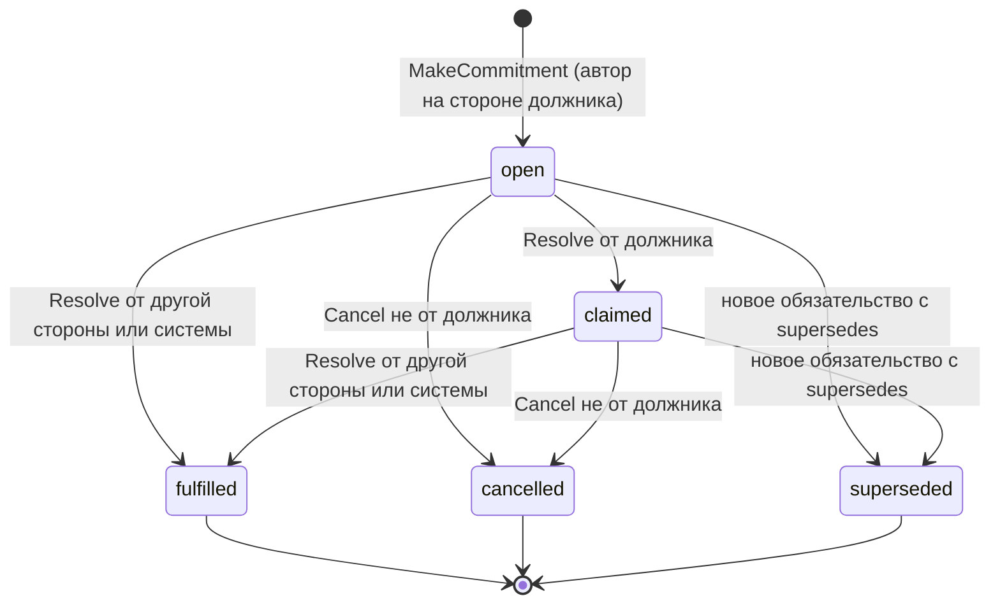

# 2. Описание предлагаемого метода

> **Статус: черновик для доработки автором.** Раздел описывает то, что
> реализовано в ветке `main` репозитория duebook на коммите `49b023f`
> (пакет `src/duebook`), а не то, что планировалось. Имена модулей,
> классов и функций даны моноширинным шрифтом, чтобы описание можно было
> сверить с кодом (соответствие подразделов модулям — в `README.md` этой
> папки). Числа экспериментов не окончательные и помечены
> «[предварительные результаты, будут обновлены]»: идёт новый раунд
> экспериментов (защиты от ложного закрытия обязательств, смена
> извлекающей модели на DeepSeek V4.1 Flash, тикеты по 150–200
> сообщений).

## 2.1. Общая схема

Метод называется **структурированной событийной памятью** обращения. Его
главная идея — разделить две роли, которые в системах памяти LLM-агентов
обычно совмещены (раздел 1.4):

- **языковая модель предлагает.** Прочитав новое событие обращения, она
  формирует список предложений по изменению состояния: «зафиксировать
  факт», «зарегистрировать обязательство», «отметить выполнение» и т. п.;
- **детерминированный слой решает.** Чистая функция без часов, сети и
  модели проверяет каждое предложение по набору правил и либо применяет
  его, либо отклоняет с указанием причины.

Состояние обращения хранится в виде **карточки** (card). Карточка — это
свёртка потока событий:

$$C_i = \mathrm{apply}(C_{i-1},\ e_i,\ P_i), \qquad P_i = R(C_{i-1}, e_i), \qquad C_0 = \varnothing,$$

где $e_i$ — $i$-е событие обращения, $R$ — извлекатель (языковая модель),
$P_i$ — его предложения, $\mathrm{apply}$ — редьюсер
(`duebook.reducer.apply`). Предложения $P_i$ сохраняются вместе с событием,
поэтому карточку на любой момент $k$ можно восстановить без повторного
обращения к модели:
$C_k = \mathrm{fold}(\mathrm{apply}, \varnothing, ((e_1, P_1), \dots, (e_k, P_k)))$
(`reducer.replay`, `Store.replay`). Это делает карточку воспроизводимой,
проверяемой и сравнимой между прогонами. Подход наследует идею event
sourcing [20]: источник истины — журнал событий, текущее состояние —
производное от него.

Вокруг этого ядра построены:

- разрешение сроков, при котором модель не вычисляет даты (2.6);
- нормализация имён слотов фактов (2.7);
- жизненный цикл обязательства (2.8) и правила его передачи (2.9);
- вывод оповещений как функции от карточки и времени (2.10);
- журнал событий, снимок карточки и outbox оповещений в PostgreSQL (2.11);
- сводка для оператора, принимающего обращение (2.12).

TODO (автор): вставить рисунок с архитектурой (вебхук → журнал событий →
процессор: извлечение + редьюсер → снимок карточки и outbox → планировщик
и доставка; чтение карточки и сводки через API). Источник для рисунка —
таблица команд в корневом `README.md` (раздел «Running the service»).

## 2.2. Входные данные: события обращения

Вход системы — упорядоченный поток событий одного обращения
(`duebook.events`). У каждого события есть идентификатор, идентификатор
обращения, порядковый номер `seq` внутри обращения (начиная с 1; он же ключ
идемпотентности) и время с часовым поясом. Реализованы три типа событий:

| Тип | Содержание |
|---|---|
| `MessagePosted` | автор (`Actor`), текст, признак публичности (внутренняя заметка клиенту не видна) |
| `AssigneeChanged` | прежний и новый ответственный оператор (любой из них может отсутствовать) |
| `StatusChanged` | прежний и новый статус обращения |

У автора сообщения есть **роль** (`customer`, `agent`, `bot`, `system`), из
которой выводится **сторона** (`Side`): клиент, компания (оператор и бот) или
система. Сторона «система» — это источник, не являющийся ничьим словом
(например, уведомление биллинга). Только такой источник наравне с
противоположной стороной может подтвердить выполнение обязательства (2.8).

События — это факты о helpdesk, а не их интерпретация. Всё, что система
«знает» об обращении, выводится из этого потока.

## 2.3. Модель данных карточки

Карточка (`duebook.card.Card`) — неизменяемое значение: редьюсер не
изменяет её, а возвращает новую. Из карточки ничего не удаляется: устаревший
факт сохраняет интервал действия и ссылку на то, что его заменило. Состав
карточки приведён в таблице 2.1.

**Таблица 2.1.** Сущности карточки

| Сущность | Поля | Назначение |
|---|---|---|
| `Source` (источник) | идентификатор и номер события, автор, сторона, **дословная цитата** | на чём основано любое утверждение карточки; у каждого убеждения есть источник |
| `Fact` (факт) | слот (например, `order.status`), значение, источник, начало действия `valid_from`, конец действия `valid_to` (пусто, пока факт текущий), `superseded_by` | сведения о деле; в каждом слоте одно текущее значение на сторону |
| `Contradiction` (противоречие) | слот, пара фактов разных сторон, момент обнаружения, момент разрешения | стороны расходятся, и никто это не урегулировал |
| `Commitment` (обязательство) | должник (`Party`: оператор лично, компания, клиент), действие, источник, момент создания, срок (`Due`), состояние, ответственный, от кого унаследовано, моменты заявления и закрытия, источник закрытия, `superseded_by` | обещание как сущность с жизненным циклом |
| `Due` (срок) | момент (`Deadline`: время и точность — до минуты или до дня), структурное выражение срока (`DueExpr`), уровень уверенности, цитата срока | разрешённый срок и степень доверия к нему |
| `Step` (шаг) | действие, источник, исход (ожидается / помогло / не помогло), источник исхода | что уже пробовали; неудачный шаг нельзя предлагать снова |
| `Question` (вопрос) | текст, источник, сторона, от которой ждут ответа, источник ответа | открытые вопросы |
| `Card` (карточка) | номер последнего учтённого события, ответственный и статус (с номерами установивших их событий), кортежи всех сущностей выше | всё, что система сейчас знает об обращении |

Отметим три свойства модели.

1. **Факт с интервалом действия.** Факт $f$ действует на интервале
   $[\mathit{valid\_from}_f, \mathit{valid\_to}_f)$; текущий — тот, у которого
   $\mathit{valid\_to}_f$ не задан. Пары «было — стало» восстанавливаются по
   ссылкам `superseded_by` (`Card.changed_facts`). Это модель
   действительного времени в смысле темпоральных баз данных [19]. Время
   транзакции в карточке не хранится, но восстанавливается по журналу
   (2.11).
2. **Должник отличается от ответственного.** Должник (`owner`) — тот, кто
   обещал: оператор лично (`agent`), компания (`company`) или клиент
   (`customer`). Ответственный (`responsible`) — оператор, который
   *сейчас* отвечает за обещание стороны компании. Ответственный может
   меняться при передаче обращения (2.9); должник не меняется никогда.
3. **Состояние обязательства хранит только то, что установлено событиями**
   (открыто, заявлено выполненным, выполнено, отменено, заменено).
   Статусы, зависящие от времени («скоро срок», «просрочено»), не хранятся,
   а вычисляются (2.8, 2.10).

## 2.4. Правило обновления и извлечение предложений

### 2.4.1. Предложения

Извлекатель может сформулировать восемь видов предложений
(`duebook.proposals`), перечисленных в таблице 2.2. Каждое несёт поле
`quote` — дословный фрагмент сообщения, на котором оно основано.

**Таблица 2.2.** Виды предложений

| Предложение | Параметры (кроме цитаты) | Смысл |
|---|---|---|
| `AssertFact` | слот, значение, признак `change` | сообщение утверждает значение; `change` — говорящий сообщает, что значение *изменилось* («перевёл вас на тариф Про»), а не оспаривает чужое |
| `MakeCommitment` | должник, действие, структурный срок `due`, дословная фраза срока `due_quote`, `supersedes` | новое обещание; `supersedes` — оно заменяет прежнее (перенос срока) |
| `ResolveCommitment` | идентификатор обязательства | кто-то говорит, что действие выполнено |
| `CancelCommitment` | идентификатор обязательства | обязательство больше не нужно |
| `RecordStep` | действие, исход | предложен или опробован шаг решения |
| `SetStepOutcome` | идентификатор шага, исход | сообщён исход шага |
| `AskQuestion` | текст | вопрос, на который должна ответить другая сторона |
| `AnswerQuestion` | идентификатор вопроса | ответ на открытый вопрос |

### 2.4.2. Редьюсер

Функция $\mathrm{apply}(C, e, P)$ (`reducer.apply`) работает так.

1. **Порядок.** Если $e.\mathit{seq} \le C.\mathit{last\_seq}$, событие уже
   учтено, и карточка возвращается без изменений (повторная доставка). Если
   $e.\mathit{seq} \ne C.\mathit{last\_seq} + 1$, возбуждается исключение
   `OutOfOrder`: упорядочение — задача слоя приёма (2.13).
2. **Служебные события.** `AssigneeChanged` выполняет передачу обращения
   (2.9), `StatusChanged` обновляет статус. Все предложения к таким событиям
   отклоняются с причиной `not_a_message`: у них нет текста, на который
   можно сослаться.
3. **Сообщение.** Предложения $p_1, \dots, p_m$ обрабатываются
   **последовательно**: каждое видит результат применения предыдущих. Для
   каждого проверяется обоснованность цитатой (2.5.1), затем специфичные
   для вида правила допуска (2.5.2–2.5.5). Новая сущность получает
   идентификатор `⟨id события⟩#⟨позиция предложения в списке⟩`. Поэтому
   при воспроизведении того же списка через тот же редьюсер получаются те же
   идентификаторы.
4. **Результат** — новая карточка и список отказов (`Rejection`:
   предложение и причина). Отказы не отбрасываются, а сохраняются: доля
   отказов — измеримая величина, по которой видно, что извлекатель
   «дрейфует».

Формально для сообщения
$C' = a_m$, где $a_0 = C$ (с обновлённым `last_seq`), а
$a_j = \mathrm{admit}(a_{j-1}, e, p_j)$, если $p_j$ допущено, и $a_j = a_{j-1}$
в противном случае.

Редьюсер — чистая функция: от календаря (`WorkCalendar`) и словаря слотов
(`Vocabulary`) он зависит только через явные параметры. Поэтому все правила
тестируются без языковой модели.

### 2.4.3. Извлечение

Извлекатель (`duebook.extract.Extractor`) показывает модели **не всю
переписку**, а:

- фиксированные инструкции (`extract/prompt.py`). Они идут первыми и не
  меняются, поэтому кэш промптов провайдера может их переиспользовать;
- текущую карточку в текстовом виде (`render_card`): ответственный и
  статус, текущие факты, нерешённые обязательства с вычисленным статусом и
  сроком, шаги, открытые вопросы. Объектам, на которые модель может
  сослаться, присвоены короткие метки `C1`, `S1`, `Q1`, а соответствие меток
  настоящим идентификаторам хранится отдельно;
- одно новое сообщение: роль и имя автора, видимость, день недели, дата и
  время в часовом поясе обращения, текст.

Модель отвечает JSON-объектом по строгой схеме (`extract/schema.py`). Схема
плоская, все поля обязательны (необязательные допускают `null`): такую форму
принимают режимы строгого структурированного вывода у разных провайдеров.
Ответ разбирается поэлементно: некорректная запись отбрасывается и
учитывается, остальные используются. Работа идёт с любым
OpenAI-совместимым API (по умолчанию OpenRouter); модель по умолчанию —
`z-ai/glm-5.3-flash` (`settings.py`).

Принципиальное правило: **неудачное извлечение возбуждает исключение и
никогда не возвращает пустой список.** Пустой список означал бы «сообщение
прочитано, ничего не найдено», и карточка продвинулась бы мимо
непрочитанного сообщения. Вместо этого обращение «задерживается» на этом
событии (2.13).

Поскольку модель видит карточку и одно сообщение, стоимость обработки
обращения растёт линейно по числу сообщений, а не квадратично, как при
перечитывании всей переписки. Это проверено на длинных тикетах: промпт
извлекателя рос примерно на 29 % за 200+ сообщений, в основном за счёт
фиксированных инструкций (`docs/results.md`, «The extractor's prompt on
long tickets») [предварительные результаты, будут обновлены]. Для очень
длинных карточек реализовано необязательное ограничение показываемой части
(`prompt.Bound`): всё, на что модель может повлиять, показывается всегда, а
урезается только история. По умолчанию ограничение выключено.

TODO (автор): после смены извлекающей модели (DeepSeek V4.1 Flash, в
другой ветке) обновить модель по умолчанию в этом подразделе и в 2.14.

## 2.5. Правила допуска предложений

### 2.5.1. Общее правило: обоснованность цитатой

Предложение допускается к дальнейшей проверке, только если его цитата
непуста и после нормализации (приведение регистра, замена «ё» на «е»,
схлопывание пробелов) входит в текст сообщения как подстрока. Иначе отказ
`ungrounded`. Так допущение модели никогда не сохраняется как слова
человека. Ссылка-источник с этой цитатой прикрепляется к каждой созданной
сущности.

Все причины отказа (`reducer.Reason`) приведены в таблице 2.3.

**Таблица 2.3.** Причины отказа

| Причина | Когда возникает |
|---|---|
| `not_a_message` | предложение к событию без текста |
| `ungrounded` | цитаты нет в сообщении |
| `empty` | пустой слот, значение, действие или текст; исход шага «ожидается» в `SetStepOutcome` |
| `duplicate` | то же значение той же стороны; такое же нерешённое обязательство того же должника; такой же шаг; такой же открытый вопрос |
| `unknown_target` | ссылка на несуществующее обязательство, шаг или вопрос; замена обязательства другой стороны |
| `already_resolved` | действие над уже закрытым обязательством или отвеченным вопросом |
| `already_claimed` | должник повторно заявляет о выполнении |
| `owner_author_mismatch` | обязательство создаёт не та сторона, которая была бы должником |
| `debtor_cannot_cancel` | должник пытается отменить собственное обязательство |
| `wrong_party` | вопрос от системы; ответ не от той стороны, от которой ждали ответа |
| `deadline_ungrounded`* | фразы срока нет в сообщении |
| `deadline_invalid`* | срок невозможно разрешить (например, 31 февраля) |
| `deadline_in_past`* | разрешённый срок не позже момента сообщения |

\* Частичный отказ: обязательство принимается **без срока**, отклоняется
только срок.

### 2.5.2. Факты: замещение, противоречие, урегулирование

Для `AssertFact` слот сначала нормализуется (2.7). Пусть $s$ — сторона
автора, $\mathit{cur}$ — текущие факты карточки в этом слоте. Правила
(`reducer._assert_fact`):

1. **Совпадающее значение.** Если в $\mathit{cur}$ уже есть факт с тем же
   значением, предложение ничего не добавляет (`duplicate`). Исключение —
   когда это значение ранее назвала *другая* сторона, а остальные текущие
   факты слота с ним расходятся. Тогда это уступка противоположной
   стороны: прочие факты слота замещаются, а открытые противоречия по слоту
   помечаются разрешёнными (урегулирование).
2. **Новое значение от системы или с признаком изменения.** Если автор —
   система или `change = true`, новое значение заменяет **все** текущие
   значения слота, а противоречия по слоту разрешаются.
3. **Новое значение той же стороны.** Если в $\mathit{cur}$ есть факт той же
   стороны, он **замещается** (закрывается интервал действия, ставится
   `superseded_by`). Открытое противоречие переводится на новое значение:
   спор идёт с последним утверждением стороны, а не с первым.
4. **Новое значение другой стороны.** Если в $\mathit{cur}$ есть только факты
   противоположной стороны, создаётся **противоречие** (`Contradiction`), а
   оба значения остаются текущими.

Тем самым разведены два случая, которые системы памяти из раздела 1.4 не
различают (1.5): изменение — это история, расхождение — открытая проблема.
В сводке и при оценке значение спорного слота не выдаётся за факт: оно
показывается как противоречие (2.12).

### 2.5.3. Обязательства: кто может обещать

Для `MakeCommitment` (`reducer._make_commitment`):

1. Действие не должно быть пустым.
2. **Никто не может связать обязательством другую сторону:** сторона автора
   должна совпадать со стороной должника. Сообщение клиента «вы обещали мне
   возврат» — это утверждение клиента о компании, а не обещание компании
   (`owner_author_mismatch`). Система не может быть должником.
3. Не должно существовать такого же нерешённого обязательства того же
   должника (с точностью до нормализации текста), кроме заменяемого.
4. Если задано `supersedes`, заменяемое обязательство должно существовать,
   принадлежать той же стороне и быть нерешённым. Тогда оно переходит в
   состояние «заменено» со ссылкой на новое: так оформляется
   **перенос срока**.
5. Срок разрешается по правилам 2.6. Ошибка в сроке — частичный отказ.
6. Ответственный: для обязательства клиента — нет; если автор — оператор,
   ответственный — сам автор; если автор — бот, ответственный — текущий
   назначенный оператор обращения, а при его отсутствии никто, и
   обязательство сразу становится «осиротевшим» (2.9). Бот не может
   отвечать за обещание.

### 2.5.4. Закрытие обязательства: заявлено или подтверждено

Для `ResolveCommitment` (`reducer._resolve_commitment`):

- если о выполнении говорит **сама сторона-должник**, обязательство
  переходит в состояние «заявлено выполненным» (`claimed`); повторное
  заявление отклоняется (`already_claimed`);
- если о выполнении говорит **другая сторона или система**, обязательство
  переходит в состояние «выполнено» (`fulfilled`).

Слова «мы отправили возврат» и «деньги пришли» — разные факты. Первое —
заявление должника, второе — подтверждение кредитора. Метод их различает,
и в сводке заявленное, но не подтверждённое выполнение показывается
отдельно (2.12).

Для `CancelCommitment` (`reducer._cancel_commitment`) должник **не может**
отменить своё обязательство (`debtor_cannot_cancel`) — только перенести
его через `supersedes`. Иначе брошенное обещание исчезло бы из вида.
Отменить обязательство может другая сторона (кредитор отказывается от
обещанного) или система.

### 2.5.5. Шаги и вопросы

Шаг (`RecordStep`) принимается, если такого действия ещё нет. Исход шага
(`SetStepOutcome`) может сообщить любая сторона, но значение «ожидается»
отклоняется. Вопрос (`AskQuestion`) задаёт клиент или компания (но не
система); ждут ответа от противоположной стороны. Ответ (`AnswerQuestion`)
принимается только от той стороны, от которой ждали ответа.

### 2.5.6. Чего правила пока не проверяют

Правила проверяют, *кто* вправе изменить обязательство, но не проверяют,
*относится ли сообщение к этому обязательству*. Предварительный эксперимент
показал, что именно здесь слабое место метода: извлекатель иногда
прикреплял `supersedes`, `cancel` или `resolved` не к тому обещанию, и
редьюсер это допускал. Нарушенное обещание, «закрытое» таким образом, не
порождает оповещения. На тестовой выборке это стоило 5 из 6 пропущенных
оповещений о нарушении срока (`docs/results.md`, «Short version» и «What the
results say about the research questions») [предварительные результаты,
будут обновлены]. Детерминированные защиты от ложного закрытия
обязательств **[в разработке]** (отдельная ветка) и в описанной здесь версии
кода отсутствуют; см. 2.15.

## 2.6. Сроки: два независимых прочтения и уровни уверенности

### 2.6.1. Модель не вычисляет даты

Языковая модель хорошо узнаёт, что «до пятницы» — это срок, но плохо
считает, какая это дата (1.7). Поэтому задача разделена
(`duebook.temporal`):

- модель (или парсер) выдаёт **структурное выражение срока** `DueExpr` —
  описание того, *что сказано*;
- функция `resolve(expr, said_at, cal)` превращает его в момент времени по
  моменту отправки сообщения, часовому поясу и рабочему календарю
  обращения.

**Таблица 2.4.** Грамматика выражений срока и правила разрешения

| Выражение | Примеры | Разрешение |
|---|---|---|
| `Offset(amount, unit)`, единица — минута или час | «через 2 часа», «в течение получаса» | момент сообщения + смещение (точность — минута) |
| `Offset`, единица — день или неделя | «через неделю» | конец календарного дня через $n$ дней ($7n$ для недель) |
| `Offset`, единица — рабочий день | «в течение 3 рабочих дней» | конец $n$-го рабочего дня после дня сообщения по календарю |
| `DayRef(days_ahead, at)` | «сегодня», «завтра», «послезавтра в 15:00» | конец дня или указанное время |
| `WeekdayRef(weekday, at, week)` | «до пятницы», «в пятницу на следующей неделе» | ближайший такой день недели (сегодня, если момент ещё не прошёл) либо этот день в календарной неделе со сдвигом `week` |
| `DateRef(day, month, year, at)` | «15 марта», «15.03» | указанная дата; без года — ближайшее будущее наступление |
| `PeriodEnd(period)` | «до конца дня / недели / месяца» | конец дня; последний рабочий день недели (сказано в выходные — следующей); последний рабочий день месяца |

Срок разрешается к **наиболее позднему правдоподобному моменту**: «до
пятницы» означает конец пятницы (по умолчанию 23:59:59 местного времени), а
не её начало. Досрочное оповещение о нарушении — ложная тревога, а ложные
тревоги приучают игнорировать оповещения. Календарь (`WorkCalendar`)
задаёт часовой пояс (по умолчанию Europe/Moscow), рабочие дни недели,
праздники и момент окончания дня. Тот же календарь используется при
воспроизведении, поэтому его нельзя менять для уже накопленных карточек.

### 2.6.2. Два независимых прочтения

Одну и ту же фразу срока читают два независимых «читателя»:

1. **модель** выдаёт структурное выражение `due`, а также дословную фразу
   срока `due_quote`;
2. **детерминированный парсер** `parse_due` для русского и английского
   языков читает фразу `due_quote` (если её нет — цитату обещания целиком).

Парсер нарочно консервативен. Ему не нужно понимать любую формулировку
(это делает модель), но, когда он отвечает, он должен быть прав, потому что
его задача — подтвердить или оспорить прочтение модели. Поэтому на
неоднозначные фразы («в следующую пятницу», «в эту пятницу», «пятница или
понедельник», «примерно», «после…», диапазоны «3–5») он не отвечает
ничего: неверное «второе мнение» оспорило бы верное первое.

Уровень уверенности (`card.Confidence`) определяется в `reducer._due` так:

| Модель дала выражение | Парсер дал выражение | Используется | Уверенность |
|---|---|---|---|
| да | да, разрешается в тот же момент | выражение модели | **высокая** (`HIGH`) |
| да | да, разрешается в другой момент (или не разрешается) | выражение модели | **низкая** (`LOW`) |
| да | нет | выражение модели | средняя (`MEDIUM`) |
| нет | да | выражение парсера | средняя (`MEDIUM`) |
| нет | нет | — | срока нет |

Перед этим проверяется, что фраза срока дословно присутствует в сообщении
(иначе `deadline_ungrounded`), что выражение разрешается
(`deadline_invalid`) и что срок не в прошлом (`deadline_in_past`).

Срок с низкой уверенностью **показывается** в карточке и сводке с
пометкой «срок распознан неуверенно, сверьте с сообщением», но **по нему
не выдаются оповещения**: политика оповещений по умолчанию требует хотя бы
средней уверенности (2.10).

TODO (автор): в докстринге `card.Confidence` средний уровень описан как
«срок смог прочитать только модель», а код присваивает его и в случае,
когда срок прочитал только парсер. В тексте выше описано поведение кода;
решить, нужно ли поправить докстринг или код (это вопрос к коду, не к
отчёту).

Предварительный эксперимент подтверждает выбор: все сроки найденных
обещаний у событийной памяти определены верно, тогда как у базовых методов,
где дату вычисляла модель, часть сроков ошибочна; около половины ошибок —
соглашение «до конца недели», остальные — арифметика рабочих дней
(`docs/results.md`, «Deadlines a model computes itself») [предварительные
результаты, будут обновлены]. Отметим угрозу валидности: эталонные сроки
бенчмарка разрешаются тем же кодом `resolve`, так что бенчмарк проверяет
верность прочтения выражения, а не саму календарную арифметику (у неё
отдельные модульные тесты).

## 2.7. Нормализация слотов

Все правила для фактов (замещение, противоречие, урегулирование) сравнивают
**слоты**. Они работают, только если одна вещь всегда попадает в один слот.
В реальных прогонах это не так: модель записала возврат в
`order.refund` в одном сообщении и в `order.refund_status` в следующем, и
обновление выглядело как второй, не связанный с первым факт.
Расхождение сторон в таком случае тоже осталось бы незамеченным.

Поэтому предложенное моделью имя слота до сравнения нормализуется
детерминированно (`duebook.slots.Vocabulary.normalise`) в три шага.

1. **Написание.** Регистр, разделители и camelCase сводятся к одной форме
   `объект.атрибут`: `Order-Status`, `orderStatus` и `order.status` — одно
   имя (`fold`).
2. **Контролируемый словарь.** Задан список канонических слотов
   (`order.number`, `refund.status`, `delivery.address`, `account.plan`,
   `device.model` и др.), у каждого — известные синонимы. Например,
   `order.refund_status` → `refund.status`, `tariff` → `account.plan`.
   Словарь же подставляется в инструкции модели.
3. **Слоты карточки.** Имя вне словаря сравнивается со слотами, уже
   имеющимися в карточке, по множеству слов без «пустых» слов (`status`,
   `state`, `current`, `info`, `value`, `details`). Если совпадение ровно
   одно, используется существующий слот: `order.gift_status`
   присоединяется к `order.gift`. При нескольких совпадениях имя
   оставляется как есть: угадывание могло бы слить разные вещи.

Словарь открыт намеренно: имя, не совпавшее ни с чем, сохраняется в
нормализованном написании. Запрет всех незнакомых слотов выбросил бы факты,
которые автор словаря не предусмотрел, а шаг 3 и так не даёт незнакомому
слоту раздвоиться. Для другой предметной области передаётся свой
`Vocabulary`. Словарь — часть того, от чего зависит воспроизведение
карточки.

## 2.8. Жизненный цикл обязательства

### 2.8.1. Состояния, установленные событиями

Карточка хранит одно из пяти состояний обязательства
(`card.CommitmentState`): открыто (`open`), заявлено выполненным
(`claimed`), выполнено (`fulfilled`), отменено (`cancelled`), заменено
(`superseded`). Обязательство в состояниях `open` и `claimed` считается
**нерешённым**. Переходы между состояниями (рис. 2.1, таблица 2.5)
определяются правилами 2.5.3–2.5.4.

*Рис. 2.1.* Диаграмма состояний обязательства (хранимые состояния)

**Таблица 2.5.** Переходы состояний обязательства

| Из | Предложение | Кто вправе | В | Иначе — отказ |
|---|---|---|---|---|
| — | `MakeCommitment` | автор на стороне должника | `open` | `owner_author_mismatch` |
| `open` | `ResolveCommitment` | сторона должника | `claimed` | — |
| `claimed` | `ResolveCommitment` | сторона должника | — | `already_claimed` |
| `open`, `claimed` | `ResolveCommitment` | другая сторона или система | `fulfilled` | — |
| `open`, `claimed` | `CancelCommitment` | другая сторона или система | `cancelled` | `debtor_cannot_cancel` |
| `open`, `claimed` | `MakeCommitment` с `supersedes` | сторона должника | `superseded` (+ новое `open`) | `unknown_target` |
| `fulfilled`, `cancelled`, `superseded` | любое | — | — | `already_resolved` |

Заметим, что «сторона должника» — это сторона, а не конкретный человек: о
выполнении личного обещания оператора может заявить и другой оператор той
же компании. Подтвердить выполнение может только противоположная сторона
или система.

### 2.8.2. Статусы, производные от времени

«Скоро срок» и «просрочено» — не события: в момент наступления срока в
обращении ничего не происходит. Поэтому они не хранятся, а вычисляются
функцией `lifecycle.status_at(c, t)` от обязательства и текущего времени:

$$
\mathrm{status}(c, t) =
\begin{cases}
\text{состояние } c, & c \in \{\text{cancelled}, \text{superseded}, \text{claimed}\},\\
\text{fulfilled\_late}, & c = \text{fulfilled} \wedge t_{\text{done}} > d_c,\\
\text{fulfilled}, & c = \text{fulfilled} \wedge \neg(t_{\text{done}} > d_c),\\
\text{open}, & c = \text{open} \wedge d_c \text{ не задан},\\
\text{breached}, & c = \text{open} \wedge t \ge d_c,\\
\text{due\_soon}, & c = \text{open} \wedge d_c - \ell_c \le t < d_c,\\
\text{open}, & \text{иначе},
\end{cases}
$$

где $d_c$ — срок, $\ell_c$ — упреждение (2.10), а $t_{\text{done}}$ —
момент *заявления* выполнения, если оно было, иначе момент подтверждения.
Опоздание оценивается по моменту, когда должник выполнил обещание, а не
когда другая сторона удосужилась это подтвердить.

Отсюда два следствия, важные для надёжности: нет фонового задания, сбой
которого оставил бы статус устаревшим, и статус на любой момент прошлого
вычисляется по карточке, восстановленной на этот момент (2.11).

## 2.9. Передача обращения: унаследованные и «осиротевшие» обязательства

Обещание, которое дал уходящий оператор, не уходит вместе с ним: компания
по-прежнему его должна. При событии `AssigneeChanged(previous, current)`
(`reducer._hand_over`) каждое **нерешённое обязательство стороны
компании** обрабатывается так:

- если за него отвечает кто-то, кроме уходящего оператора, оно не
  меняется;
- если за него уже отвечает новый оператор, оно не меняется;
- иначе ответственным становится новый оператор, а в поле
  `inherited_from` записывается прежний ответственный (если ответственного
  не было — сохраняется прежнее значение поля).

Если новый оператор не назначен (`current` пуст), у обязательства не
остаётся ответственного. Такое обязательство называется **осиротевшим**
(`Commitment.orphaned`: нерешённое, не клиента, без ответственного). Именно
в этом состоянии обещания теряются чаще всего, поэтому сводка выводит его
явно («БЕЗ ОТВЕТСТВЕННОГО»). Когда обращение снова назначают, осиротевшие
обязательства переходят к новому оператору с пометкой о наследовании.
Обязательства клиента при передаче не меняются.

Пример: оператор Иван обещает перезвонить (ответственный — Иван); обращение
передают Ольге (ответственная — Ольга, унаследовано от Ивана); затем
обращение остаётся без исполнителя (ответственного нет, обязательство
осиротевшее, унаследовано от Ольги); затем его назначают Петру
(ответственный — Пётр, унаследовано от Ольги).

Кроме того, оповещение, ожидающее в очереди, при отправке адресуется тому,
кто отвечает **сейчас**, а не тому, кто отвечал в момент постановки в
очередь (2.11).

TODO (автор): обсудить ограничение. Обязательство, данное оператором,
который не был назначенным исполнителем (например, подключился к
переписке), при смене назначенного исполнителя не переносится: за него
продолжает отвечать дававший его оператор. Решить, описывать ли это как
осознанное решение или как направление доработки.

## 2.10. Оповещения как функция карточки и времени

Множество оповещений, актуальных в момент $t$, — это функция
$N(C, t)$ (`lifecycle.notices`). Обязательство $c$ может породить
оповещение, если оно **открыто** (`open`), имеет срок, уверенность срока не
ниже порога политики, срок не раньше момента ввода системы в эксплуатацию
(если он задан) и должник — не клиент (если политика не требует иного). Для
такого $c$ оповещение вида «нарушено» (`breached`) или «скоро срок»
(`due_soon`) выдаётся, когда $\mathrm{status}(c, t)$ принимает
соответствующее значение.

Политика `AlertPolicy` по умолчанию:

| Параметр | Значение | Смысл |
|---|---|---|
| `due_soon_lead` | 4 ч | за сколько до срока предупреждать |
| `max_lead_fraction` | 0,5 | упреждение не больше этой доли всего срока обещания |
| `min_confidence` | `MEDIUM` | по срокам с низкой уверенностью оповещений нет |
| `include_customer` | нет | оповещать ли о просрочке обещаний клиента |
| `alerts_since` | не задано | не оповещать о сроках раньше этого момента |

Упреждение вычисляется как
$\ell_c = \min(\Delta_{\text{lead}},\ \rho \cdot (d_c - t^{\text{created}}_c))$,
чтобы обещание ответить «через 10 минут» не порождало предупреждения в
момент его дачи. Параметр `alerts_since` нужен при подключении системы к
обращениям с историей. Без него импорт истории поставил бы в очередь
оповещение о каждом давно нарушенном обещании, и этот поток похоронил бы те
оповещения, по которым ещё можно действовать. Само обязательство при этом
остаётся нарушенным в карточке и сводке; не отправляется только
оповещение.

Оповещение идентифицируется тем, **о чём** оно, а не тем, когда его
заметили: его ключ —
`⟨обращение⟩:⟨обязательство⟩:⟨вид⟩:⟨срок в ISO 8601⟩`.
Получатель — ответственный за обязательство компании или назначенный
оператор, если должник — клиент. Повторный вывод при тех же входных данных
даёт те же ключи. При переносе срока у нового обязательства новый
идентификатор и срок, а значит, и новые ключи.

Функция `lifecycle.next_wakeup(C, t)` возвращает ближайший будущий момент,
в который $N$ может измениться:
$\min\{m \in \bigcup_c \{d_c - \ell_c,\ d_c\} : m > t\}$. Каждая строка
обращения в базе хранит этот момент, и планировщик спит до ближайшего из
них, а не опрашивает все обращения (2.11).

## 2.11. Хранение и доставка: журнал, снимок, outbox

### 2.11.1. Журнал событий и снимок

Хранилище (`duebook.store`, PostgreSQL) содержит:

- **журнал событий** `events`. Только дописывание: триггер запрещает
  `UPDATE` и `DELETE`. Ключ — пара (обращение, `seq`). Повторная доставка
  того же события распознаётся и игнорируется, а *другое* событие на занятой
  позиции считается конфликтом и не отбрасывается молча;
- **предложения** `event_proposals`: полный список предложений к событию в
  исходном порядке, отказы с причинами, расход токенов. Тоже только
  дописывание. Наличие строки означает, что событие применено;
- **снимок карточки** в строке обращения `tickets` вместе с моментом
  следующего пробуждения `wake_at`. Снимок — кэш свёртки журнала; его можно
  выбросить и пересчитать (`Store.rebuild`);
- **outbox** оповещений (2.11.2).

Применение одного события — **одна транзакция**, в которой записываются
предложения и отказы, новый снимок карточки, новые оповещения в outbox и
новый `wake_at`. Нет момента, когда снимок опережает журнал или существует
оповещение о состоянии карточки, которое не было сохранено. Это и есть
transactional outbox [29]: изменение состояния и постановка сообщения в
очередь атомарны.

Воспроизведение (`Store.replay(ticket, upto)`) строит карточку только по
журналу и сохранённым предложениям, без модели. Через API доступна карточка
на момент любого события (`GET /tickets/{id}/card?as_of=<seq>`).

### 2.11.2. Доставка: ровно один раз для получателя

Ключ оповещения — первичный ключ таблицы `outbox`. Поэтому, сколько бы раз
перезапущенный планировщик ни выводил одно и то же оповещение, в очередь
оно попадёт один раз (`insert … on conflict do nothing`). Рабочий процесс
доставки (`store.worker.Worker`) выполняет четыре шага, и их порядок
определяет свойства системы.

1. **Захват.** Отдельной транзакцией захватывается пакет неотправленных
   оповещений (`FOR UPDATE SKIP LOCKED`). Захват — это аренда с токеном.
   Аренда старше `claim_ttl` (по умолчанию 5 минут) считается
   принадлежащей упавшему процессу и перехватывается.
2. **Проверка.** Перед отправкой оповещения снова выводятся из *текущей*
   карточки. Если оповещение больше не следует из неё (клиент подтвердил
   возврат, срок перенесён), оно снимается (`discard`), а не отправляется.
   Получатель берётся из текущей карточки: если обращение передали, пока
   оповещение ждало, его получит новый ответственный.
3. **Отправка** через канал (`log` — строки JSON в stdout, `webhook` —
   POST с заголовком `Idempotency-Key: <ключ оповещения>` и, при заданном
   секрете, подписью HMAC-SHA256). При ошибке канала оповещение
   возвращается в очередь с экспоненциальной задержкой (от 30 с с
   удвоением до 1 ч).
4. **Запись о доставке** — после отправки, а не до неё. Отметка ставится,
   только если её ещё нет.

Отправку нельзя сделать атомарной с записью о ней: процесс может упасть
между ними. Порядок «отправить, затем записать» превращает такой сбой в
повторную *попытку* с тем же ключом, а обратный порядок превратил бы его в
потерю оповещения, что хуже. Отсюда гарантия:

- **не теряется ни одно оповещение** — неподтверждённое оповещение снова
  станет доступно по истечении аренды;
- **доставка записывается один раз**;
- **получатель видит каждое оповещение ровно один раз** при единственном
  требовании к внешнему миру: канал должен считать ключ оповещения ключом
  идемпотентности [29; 30].

Это свойство проверяется тестом `tests/test_delivery_crash.py` двумя
способами: детерминированно (процесс «убивается» до и после каждой
отправки в пакете) и грубо (реальные процессы доставки получают SIGKILL в
случайные моменты, пока два из них разбирают 300 оповещений). В типичном
прогоне, приведённом в корневом `README.md`: 300 оповещений, 20 SIGKILL, 36
оповещений перехвачено после упавшего процесса, 7 повторных попыток
поглощены ключом, 0 потерь, 0 дублей.

TODO (автор): прогнать `tests/test_delivery_crash.py` самому с PostgreSQL
(`TEST_DATABASE_URL=…`) и привести числа своего прогона.

### 2.11.3. Планировщик

Планировщик (`store.scheduler`) обрабатывает обращения, у которых
`wake_at ≤ t` (это диапазон по частичному индексу, а не полный просмотр):
выводит и ставит в очередь их оповещения, сдвигает `wake_at` в одной
транзакции и засыпает до ближайшего `wake_at`, но не дольше
`max_idle` (по умолчанию 30 с), потому что новое событие может создать
более раннее пробуждение. Аварийная остановка в любой точке безопасна:
обращение останется «должным», работа повторится, а ключ outbox не даст
поставить оповещение дважды.

## 2.12. Сводка при передаче обращения

Сводка (`duebook.brief.compose`) — детерминированное представление
карточки на русском языке для оператора, принимающего обращение. **Её не
пишет модель**, поэтому она не может сказать того, чего нет в карточке, а
одна и та же карточка в один и тот же момент всегда даёт один и тот же
текст. Разделы упорядочены по тому, насколько дорого обойдётся пропуск:

1. просроченные обещания и обещания, срок которых скоро наступит
   (сначала нарушенные, затем ближайшие; обещания компании раньше обещаний
   клиента);
2. обещания, перешедшие по наследству или оставшиеся без ответственного
   (осиротевшие первыми);
3. остальные невыполненные обещания;
4. открытые противоречия между сторонами;
5. что известно сейчас (текущие факты, кроме спорных: спорное значение
   показывается один раз, как противоречие);
6. что изменилось («было — стало»);
7. что не помогло (неудачные шаги — не предлагать снова);
8. открытые вопросы.

Каждая строка заканчивается ссылкой на сообщение, на котором она основана:
номер в обращении, автор и дословная цитата. В строке обязательства
отмечаются срок с его точностью, низкая уверенность срока, заявленное, но не
подтверждённое выполнение, ответственный, прежний ответственный и
отсутствие ответственного. Пример строк сводки приведён в корневом
`README.md` (раздел «The handoff brief»).

Сводка укладывается в бюджет токенов. Сначала удаляются целые разделы с
конца этого порядка, а если остался только первый — его строки с конца. В
конце сводки перечисляется, что не поместилось и сколько элементов было в
каждом разделе («Не поместилось в лимит 330 токенов: что известно сейчас
(3), открытые вопросы (1)»), чтобы короткую сводку нельзя было принять за
полную. Токены по умолчанию оцениваются пессимистично для русского текста
(2,5 символа на токен); можно передать счётчик настоящего токенизатора.

TODO (автор): вставить пример сводки по одному из сгенерированных тикетов
(например, вывод `GET /tickets/{id}/brief` на тестовом стенде) как рисунок
или листинг.

## 2.13. Обработка потока событий и программная обвязка

Метод доведён до работающего сервиса (`duebook.pipeline`,
`duebook.api`, `duebook.cli`):

- **приём отделён от обработки.** Вебхук `POST /events` только сохраняет
  событие (с проверкой подписи HMAC, если задан секрет) и сразу отвечает
  202: helpdesk не ждёт вызова модели. Событие сохраняется до любой другой
  обработки и после этого не может потеряться;
- **строгий порядок.** События одного обращения применяются строго по `seq`
  под рекомендательной (advisory) блокировкой обращения. Событие,
  пришедшее раньше предшественника, ждёт в журнале и применяется в том же
  проходе, что закрывает разрыв. Несколько процессоров работают
  параллельно и пропускают обращения, занятые другими;
- **задержка при сбое извлечения.** Если модель не смогла прочитать
  сообщение, обращение задерживается (hold) на этом событии с текстом
  ошибки, стоимостью неудачных вызовов и временем повторной попытки
  (экспоненциально от 1 мин до 1 ч). Пустой результат не записывается, и
  следующие события не применяются, потому что каждое следующее прочтение
  опиралось бы на карточку, пропустившую сообщение. Другие обращения не
  затрагиваются;
- **чтение.** `GET /tickets/{id}/card` (с `as_of` для состояния на момент
  события), `GET /tickets/{id}/brief` (текст или JSON с источниками каждой
  строки), `GET /tickets/{id}/status`, `GET /health`;
- **процессы.** `duebook migrate | serve | process | schedule | deliver` —
  один образ на все роли; конфигурация через переменные окружения.

Состояние проверки на момент сверки: реализация покрыта автоматическими
тестами (около 290 тестовых функций в `tests/`; тесты хранилища, API и
сервиса требуют PostgreSQL). Каждая команда сервиса запускалась с локальной
PostgreSQL и заглушкой модели; `Dockerfile` и `docker-compose.yml` проверены
только `docker compose config` (корневой `README.md`, раздел «Status»).

TODO (автор): перед сдачей прогнать `pytest -q` с `TEST_DATABASE_URL` и
привести точное число тестов и результат прогона.

## 2.14. Методика оценки (кратко)

Подробная методика и результаты — в разделе экспериментов отчёта и в
`docs/results.md`. Здесь только то, что относится к методу.

- **Синтетические тикеты с заложенными событиями** (`bench/generate.py`).
  Сначала задаются события — обещание выполненное, нарушенное, расплывчатое,
  оставшееся открытым к концу, обещание клиента, обещание с далёким сроком,
  изменение тарифа компанией и адреса клиентом, споры о сумме (половина
  потом урегулирована) и модели товара, неудачный шаг, снова предложенный
  новым оператором, — а переписка строится вокруг них. Разметка поэтому
  верна по построению. Тикет — 50–64 сообщения (профиль `long` — 200–230),
  не меньше двух передач, несколько дней; большая часть — «наполнитель».
  Текст шаблонов переписывает другая модель с сохранением заложенных
  фрагментов.
- **Проверка согласованности.** К каждому тикету прилагаются предложения
  идеального извлекателя. Пропущенные через настоящий редьюсер, они дают 1,0
  по всем метрикам, что проверяет согласие генератора, редьюсера и
  оценщика до измерения любой модели.
- **Базовые методы** с той же моделью: полный контекст, скользящее
  резюме, Mem0 (открытая версия 2.2.1). Все методы отвечают в одном формате
  в моменты передачи и в конце тикета, и всех оценивает один оценщик
  (`bench/score.py`).

Предварительный прогон (20 тестовых и 2 длинных тикета) приведён в
`docs/results.md` [предварительные результаты, будут обновлены]. Там же —
угрозы валидности: синтетические тикеты, генератор написан той же командой,
одна извлекающая модель, небольшая тестовая выборка.

TODO (автор): после нового раунда экспериментов (DeepSeek V4.1 Flash, тикеты
150–200 сообщений, защиты от ложного закрытия) заменить ссылки и сравнить с
предыдущим прогоном.

## 2.15. Ограничения и работа в процессе

**В разработке** (в описанной версии кода отсутствуют):

- детерминированные **защиты от ложного закрытия обязательств**, то есть
  проверка того, что сообщение, которое закрывает, отменяет или переносит
  обязательство, действительно относится к нему (см. 2.5.6) [в разработке];
- переход извлекателя на модель **DeepSeek V4.1 Flash** [в разработке];
- эксперименты на тикетах по **150–200 сообщений** [в разработке].

**Ограничения текущей версии:**

- нет адаптера к реальной helpdesk-платформе: события подаются в
  собственном формате через вебхук;
- нет проверки на реальных обращениях: все измерения на синтетических
  тикетах;
- извлекатель читает сообщения по одному. Ссылки на сказанное много
  сообщений назад он понимает только через карточку: если карточка чего-то
  не сохранила, модель этого не увидит. Это сознательное решение (линейная
  стоимость), но и источник ошибок;
- правила допуска проверяют право стороны, но не относимость сообщения к
  обязательству (2.5.6);
- словарь слотов и парсер сроков рассчитаны на русский и английский
  языки и на домен интернет-магазина и подписок.

TODO (автор): дополнить список ограничений после обсуждения с
руководителем; решить, выносить ли его в «Заключение».
