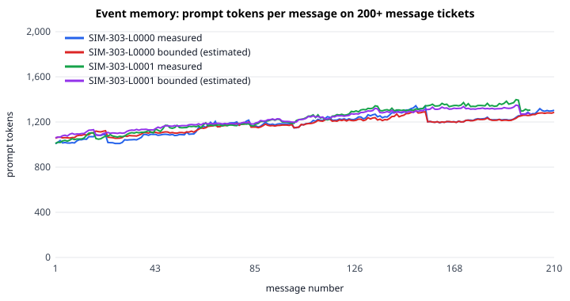

# Results: event memory against three baselines

Two rounds, both run on 2026-11-17. Round 2 comes first; round 1 follows as
it was written.

## Round 2: long tickets, DeepSeek V4.1 Flash, and closes that fail safe

Round 1 found the method's worst flaw: the extractor sometimes attached
"done", "cancelled" or "replaced" to the wrong promise and the reducer
admitted it, silently retiring promises that were then broken. Round 2 adds
close guards to the reducer, reads with DeepSeek V4.1 Flash instead of GLM 5.3
Flash, and makes long tickets (150–200 messages) the main test. Raw records:
`results/round2/`.

### Short version

On the 20 test tickets (150–191 messages, 3–4 handoffs, 10–19 days each):

- **No false close.** The event memory closed no promise that was still owed:
  0 at the end of any ticket, and 0 at any of the 87 handoff and end
  checkpoints, out of 156 closes it should have made (it made 153; one more
  was held back as a suggestion, correctly). Round 1's event memory, re-scored
  with the same measure, made 6 false closes at the end of its 20 shorter
  tickets (15 across checkpoints). Breach-alert recall is 1.000 (round 1:
  0.812).
- **But the guards did not cause that on the test split.** Folding the same
  recorded proposals again with the guards off also gives 0 false closes:
  DeepSeek with the revised instructions made none of the wrong closes the
  guards exist to stop. On test the guards refused one close, a true one (the
  model dropped a word when copying the promise's wording), which cost one
  false alert; the promise stayed open with a correct "possibly done" note.
  On the dev split, where the instructions were still being tuned, the final
  guards stopped 5 false closes and blocked no true one. The adversarial
  suite (`tests/test_guards.py`) shows the cases they exist for.
- **Promises and deadlines.** Commitment F1 0.993 against 0.998 for full
  context (indistinguishable); every deadline right (287/287) against 0.885
  for full context and 0.914 for Mem0 (paired intervals exclude zero).
- **Current context.** Freshness error 0.083 against 0.291 for full context
  and 0.318 for Mem0; dispute recall 0.928 against 0.506 and 0.619. On long
  tickets the baselines' context degrades much more than the card's.
- **Cost.** $0.012 per ticket ($0.00007 per message) for the event memory,
  $0.004 for full context asked only at checkpoints, $0.052 for Mem0 and
  $0.14 for the rolling summary. Rolling summary and Mem0 ran on the first 4
  tickets only, for budget; 3 of the rolling summary's 4 tickets ran into the
  spending cap in their last 15% of events and could not answer their final
  checkpoint.

The whole round — probes, the writer trial, rewriting, four dev runs and the
test run — was charged $1.40 of the $1.50 allowed.

### What changed since round 1

Three things changed at once, and the comparison with round 1 has to keep
them apart:

1. **Closing fails safe** (`duebook.closing`, `reducer.Guards`). Round 1's
   worst flaw was the reducer admitting "done", "cancelled" or "replaced"
   attached to the wrong promise: it checked *who* may close a promise, never
   *whether the message was about it*. Now a close names its target twice —
   the handle and `target_quote`, a span copied from the target's original
   wording, shown on the card — and is admitted only if the two agree, the
   closing words share content with the target (or plainly confirm a deed
   when the target is the only open promise of its side), no other open
   promise of that side fits as well, and a renegotiation names the same
   thing as the promise it replaces. A refused close stays on the promise as
   a suggestion; the promise stays open and alerting. Bare thanks closes
   nothing, in the extractor's instructions and in the baselines' question.
2. **The reader is DeepSeek V4.1 Flash** with reasoning off and its routing
   pinned to one host, for every method, instead of GLM 5.3 Flash.
3. **The main test is long tickets** (the `main` profile: 150–200 messages,
   3–4 handoffs, about two weeks, mostly filler) that also plant what makes a
   close easy to misplace: near-identical promises open at once, one kept and
   one broken; a renegotiation; a cancellation. Round 1's tickets planted
   none of these.

Because the guards live in the reducer, their effect can be measured exactly:
the event memory's recorded proposals are folded again with the guards off
(`event_memory_unguarded`) — same model output, same tickets, no model call.
The model and the ticket length cannot be separated as cleanly; see
[Comparison with round 1](#comparison-with-round-1).

### What was run

| | |
|---|---|
| Extracting model, every method | `deepseek/deepseek-v4.1-flash` via OpenRouter, reasoning off, routing pinned to DeepInfra's fp8 host (`order: ["deepinfra/fp8"]`, fallbacks allowed), temperature 0; all 3,446 event-memory calls were served by DeepInfra (the baselines' hosts were not recorded) |
| Writer (rewrites ticket text) | `~z-ai/glm-flash-latest` (served as `z-ai/glm-5.3-flash`), reasoning off, temperature 0.8 |
| Mem0 | `mem0ai==2.2.1`, LLM as above with the same reasoning and routing, embedder `openai/text-embedding-3-small`, local Qdrant per ticket |
| Test split | `test2`: seed 4242 (new), 20 tickets, 150–191 messages (mean 172.3), 13 with 3 handoffs and 7 with 4, 10–19 days, 287 planted promises (123 kept, 91 broken, 40 still open, 20 renegotiated, 13 cancelled); run once |
| Dev split | `dev2`: seed 4141, 4 tickets of 168–186 messages; four runs of the event memory only |
| Subsets | event memory and full context on all 20 test tickets; rolling summary and Mem0 on the first 4, for budget (projected $0.34 and $0.22 for those 4) |
| Checkpoints | every handoff and the end of the ticket |
| Intervals | 95% percentile bootstrap over tickets (2,000 resamples); differences paired on the same resamples, over the tickets both methods ran on |
| Response cache | answers to temperature-0 requests kept on disk, keyed by the whole request; nothing was re-run on test |
| Total charged | $1.399 by the run logs (`results/round2/spend.jsonl`), $1.390 by the OpenRouter key's counter; cap $1.50 |

**Tickets.** The `main` profile keeps everything round 1 planted — kept,
broken, vague, pending and customer promises, a long-deadline promise made
early, plan and address changes, amount and model disputes, a failed fix
repeated after a handoff — and adds the three things that make a close easy
to misplace: one or two pairs of near-identical promises made within three
hours of each other ("we'll refund the delivery" / "we'll refund the case";
"I'll call about the payment" / "...about the instalments"; "we'll send the
warranty card" / "...the contract"), one kept and one broken, with the
confirmation of one arriving while the other is still owed; a promise
renegotiated to a later date before it fell due; and, in about half the
tickets, a promise the customer calls off. About 80% of messages are filler.

**What changed in the methods' instructions.** The extractor is shown each
open promise with the words it was made in, asked for `target_quote` on every
close, for the whole promise clause as a commitment's quote, and told that
bare thanks confirms nothing and that a similar-sounding promise about
something else is new, not a renegotiation. The baselines' shared question got
the same bare-thanks rule ("a confirmation closes only the promise it names")
and now reports the message that closed each promise (`closed_seq`), so the
wrong-target measure applies to every method.

**New measures.** For every method, at every checkpoint, over the promises it
found: a *false close* (it holds the promise as done, claimed, cancelled or
replaced while the label says it is still owed — still open, or broken), a
*wrong-target close* (closed, and so is the label, but by a different
message), a *missed close* (still open although the label is closed), and the
event memory's *suggestions* (closes held back; right when the message is the
one that closed the promise). *Status accuracy* now distinguishes owed, done
and dropped (cancelled or replaced): round 1 judged done / not done, so a
promise wrongly called cancelled counted as right there.

### Choosing the writer

The tickets must be rewritten by a model other than the one that reads them,
so with DeepSeek reading, DeepSeek could no longer write. Seven cheap models
with strict structured output were tried on the same 60 dev messages (40 of
them planted, so harder than an average ticket), at temperature 0.8:

| writer | discarded (lost a span, not one message) | returned unchanged | reworded but added content | reworded and kept | USD for 60 |
|---|---|---|---|---|---|
| mistralai/mistral-nemo | 6 | 46 | 3 | 5 | 0.00025 |
| mistralai/mistral-small-24b-instruct-2501 | 16 | 5 | 13 | 26 | 0.00061 |
| mistralai/mistral-small-3.2-24b-instruct | 19 | 1 | 17 | 23 | 0.00114 |
| google/gemma-3-12b-it | 5 | 8 | 12 | 35 | 0.00181 |
| google/gemma-3-27b-it | 46 | 0 | 9 | 5 | 0.00159 |
| qwen/qwen3-30b-a3b-instruct-2507 | 5 | 31 | 5 | 19 | 0.00134 |
| **~z-ai/glm-flash-latest**, reasoning off | 14¹ | 13 | 0¹ | **33** | 0.00172 |

¹ GLM was tried last, after the stricter check below existed, so its 14
discards include rewrites that added content; the other rows were judged
against that check afterwards, from the saved outputs.

The discard rate alone misled: Mistral Nemo "kept every span" by returning
the text unchanged. And the cheap writers that did reword added things a
label would have to account for — "мы разберёмся" after a status ping, "так
и не привезли" after a thank-you, a complaint about bonuses after a
confirmation — so a rewrite is now also discarded when it has more numbers,
questions, negations or promise-like verbs than the original
(`bench.rewrite.acceptable`). Judged that way, GLM Flash (the alias is served
as `z-ai/glm-5.3-flash`) reworded the most and added nothing; Gemma 3 12B,
the next, wrote stray markup ("}", "(none)") into the text, and Mistral Small
drifted in meaning and in the speaker's gender. With reasoning on, GLM cost
six times as much ($0.0107 for the 60) for the same work. The cheapest
writer that rewrites reliably is therefore GLM Flash with reasoning off, at
about $0.03 per thousand messages. On the full splits it rewrote dev2 and
test2 once, for $0.115; 21% of test messages (725 of 3,446) were discarded
and a further 6% came back unchanged, so 27% keep their template wording
(round 1: 5.6%, under a looser check).

### Test split (20 tickets)

Closes, at the end of each ticket:

| metric | event_memory | full_context | rolling_summary (4) | mem0 (4) | event_memory, guards off (replay) |
|---|---|---|---|---|---|
| **false closes per ticket** | 0.000 [0.000, 0.000] | 0.000 [0.000, 0.000] | 0.000 [0.000, 0.000] | 0.000 [0.000, 0.000] | 0.000 [0.000, 0.000] |
| false closes per ticket, any checkpoint | 0.000 [0.000, 0.000] | 0.050 [0.000, 0.150] | 0.000 [0.000, 0.000] | 0.000 [0.000, 0.000] | 0.000 [0.000, 0.000] |
| wrong-target closes per ticket | 0.000 [0.000, 0.000] | 0.050 [0.000, 0.150] | 0.000 [0.000, 0.000] | 0.000 [0.000, 0.000] | 0.000 [0.000, 0.000] |
| missed-close rate | 0.019 [0.000, 0.039] | 0.051 [0.020, 0.086] | 0.125 [0.000, 0.125] | 0.031 [0.000, 0.094] | 0.013 [0.000, 0.032] |
| close precision | 1.000 [1.000, 1.000] | 0.993 [0.978, 1.000] | 1.000 [1.000, 1.000] | 1.000 [1.000, 1.000] | 1.000 [1.000, 1.000] |
| suggestions per ticket | 0.050 [0.000, 0.150] | — | — | — | — |

The same, counted:

| method | tickets | closes right | **false** | wrong target | missed | suggestions (right / other) |
|---|---|---|---|---|---|---|
| event_memory | 20 | 153 | **0** | 0 | 3 of 156 | 1 / 0 |
| full_context | 20 | 147 | 0 (1 at a handoff) | 1 | 8 of 156 | — |
| rolling_summary | 4 | 7 | 0 | 0 | 1 of 8 | — |
| mem0 | 4 | 31 | 0 | 0 | 1 of 32 | — |
| event_memory, guards off | 20 | 154 | 0 | 0 | 2 of 156 | — |

(The rolling summary's 8 are the closes of the one ticket whose end it
reached; see below.)

Accuracy at the end of each ticket:

| metric | event_memory | full_context | rolling_summary (4) | mem0 (4) |
|---|---|---|---|---|
| commitment precision | 0.986 [0.973, 0.997] | 1.000 [1.000, 1.000] | 1.000 [1.000, 1.000] | 0.983 [0.954, 1.000] |
| commitment recall | 1.000 [1.000, 1.000] | 0.997 [0.989, 1.000] | 0.217 [0.000, 0.672] | 0.967 [0.897, 1.000] |
| **commitment F1** | 0.993 [0.986, 0.998] | 0.998 [0.995, 1.000] | 0.356 [0.000, 0.804] | 0.975 [0.943, 1.000] |
| **deadline accuracy** | 1.000 [1.000, 1.000] | 0.885 [0.834, 0.930] | 1.000 [1.000, 1.000] | 0.914 [0.828, 0.981] |
| status accuracy | 0.990 [0.979, 1.000] | 0.969 [0.945, 0.986] | 0.923 [0.923, 1.000] | 0.983 [0.952, 1.000] |
| breach-alert precision | 0.968 [0.937, 1.000] | 0.928 [0.877, 0.970] | 0.800 [0.800, 1.000] | 0.950 [0.880, 1.000] |
| **breach-alert recall** | 1.000 [1.000, 1.000] | 0.989 [0.966, 1.000] | 0.211 [0.000, 0.706] | 1.000 [1.000, 1.000] |
| false alerts per ticket | 0.150 [0.000, 0.300] | 0.350 [0.150, 0.650] | 0.250 [0.000, 0.750] | 0.250 [0.000, 0.750] |

Context, over every handoff and the end (87 checkpoints; 16 for the subsets):

| metric | event_memory | full_context | rolling_summary (4) | mem0 (4) |
|---|---|---|---|---|
| **freshness error** (lower is better) | 0.083 [0.023, 0.149] | 0.291 [0.233, 0.340] | 0.159 [0.000, 0.360] | 0.318 [0.173, 0.400] |
| freshness error, handoffs only | 0.079 [0.020, 0.141] | 0.281 [0.218, 0.336] | 0.175 [0.000, 0.360] | 0.319 [0.132, 0.411] |
| fact change right | 1.000 [1.000, 1.000] | 1.000 [1.000, 1.000] | 0.722 [0.400, 0.920] | 1.000 [1.000, 1.000] |
| dispute precision | 1.000 [1.000, 1.000] | 1.000 [1.000, 1.000] | 1.000 [1.000, 1.000] | 1.000 [1.000, 1.000] |
| dispute recall | 0.928 [0.835, 1.000] | 0.506 [0.389, 0.618] | 0.619 [0.433, 0.889] | 0.619 [0.143, 0.857] |
| failed-step precision | 1.000 [1.000, 1.000] | 0.720 [0.665, 0.780] | 1.000 [1.000, 1.000] | 0.636 [0.600, 0.727] |
| failed-step recall | 0.981 [0.940, 1.000] | 1.000 [1.000, 1.000] | 0.750 [0.600, 0.938] | 1.000 [1.000, 1.000] |
| unanswered checkpoints | 0.000 | 0.000 | 0.188 (3 of 16) | 0.000 |

Paired differences, method minus event memory, over the tickets both ran on
(`*`: the interval excludes zero):

| metric | full_context (20) | rolling_summary (4) | mem0 (4) |
|---|---|---|---|
| commitment F1 | +0.005 [−0.002, +0.012] | −0.644 [−1.000, −0.196] * | −0.025 [−0.057, +0.000] |
| deadline accuracy | −0.115 [−0.166, −0.070] * | +0.000 | −0.086 [−0.172, −0.019] * |
| breach-alert recall | −0.011 [−0.034, +0.000] | −0.789 [−1.000, −0.294] * | +0.000 |
| false alerts per ticket | +0.200 [+0.000, +0.450] | +0.000 [−0.750, +0.750] | +0.000 [−0.750, +0.750] |
| freshness error | +0.207 [+0.143, +0.273] * | +0.077 [−0.177, +0.360] | +0.237 [+0.083, +0.400] * |
| fact change right | +0.000 | −0.278 [−0.600, −0.080] * | +0.000 |
| dispute recall | −0.422 [−0.582, −0.271] * | −0.381 [−0.567, −0.111] * | −0.381 [−0.857, −0.143] * |
| failed-step recall | +0.019 [+0.000, +0.060] | −0.250 [−0.400, −0.062] * | +0.000 |
| USD per ticket | −0.008 * | +0.128 * | +0.039 * |

Deadlines of the promises each method found, at the end: the event memory
287 of 287 right; full context 253 of 286, with 17 errors that are the "end
of week" convention (Sunday instead of Friday) and 16 that are arithmetic,
mostly business-day counting; Mem0 53 of 58 (2 convention, 3 arithmetic).

**The rolling summary was cut short.** Its cost was projected from the first
20 events of a ticket at $0.34 for its 4 tickets; it cost more than $0.56,
because its summaries grew to 963–1,883 words — it ignored its 500-word bound
— and it rewrote the whole summary after each of ~185 events (304,000
completion tokens a ticket). Three of its four tickets reached the run's
spending cap at events 159, 180 and 195 of 177, 193 and 195, so their last
checkpoint is unanswered and their end-of-ticket figures above (F1 0.356,
alert recall 0.211) measure the cut, not the method. At the 12 handoff
checkpoints that every method answered on those 4 tickets, it found 100 of
104 promises (event memory 104), its deadlines were 0.910 right (event memory
1.000), it missed 10 of 44 closes (event memory 2 of 47) and made 6 false
alerts (event memory 2), and its freshness error was 0.175 (event memory
0.086). It made no false close.

### Every false close, explained

*The invariant asked for:* false closes on the test split, zero or as close
to it as possible. **The event memory made none** — at the end of any ticket
or at any handoff, with the guards on and with them off.

Other methods: full context made one, at a handoff of SIM-4242-M0018: it
reported "Пришлём вам накладную до конца недели" (a promise that was broken)
as *claimed*, citing message 90, "Вам отправлено по накладной VC-626" — the
company's side of the dispute about which model was shipped, which mentions
a waybill and promises nothing. By the end it had the promise open again. It also made one wrong-target close
(SIM-4242-M0010): the renegotiated "выслать трек-номер" reported as fulfilled
by the confirmation of its replacement. Rolling summary and Mem0 made none on
their 4 tickets.

What the event memory got wrong instead, all of it visible:

- **One true close held back by the guards** (SIM-4242-M0016, message 99,
  "Деньги за доставку пришли, спасибо!"). The model copied the promise's
  wording as "вернём деньги за доставку" from "Мы вернём вам деньги за
  доставку через неделю", dropping "вам", so the two references did not agree
  and the close was refused. The promise stayed open with "возможно,
  выполнено по сообщению №99 — подтвердите" in the brief — a correct
  suggestion — and its deadline later raised one false alert. Comparing the
  span word by word, allowing skipped function words, would have admitted it;
  that change was found on the test split and was not made.
- **Two closes the model did not propose** (M0002 and M0019: "Спасибо, что
  отписались по возврату"). Nothing was proposed, so nothing could be
  admitted; both promises stayed open and each raised a false alert after its
  deadline. These are the other two of the three false alerts.
- **Four extra promises** (precision 0.986), all from filler the writer turned
  into a vague promise: "Новой информации пока нет" became "...как только что-то
  появится — сразу дадим знать". The extractor read them correctly as vague
  promises; no label accounts for them. They carry no deadline and raised no
  alert. The writer check (`rewrite.acceptable`) does not know "дадим знать",
  "уведомим", "проинформируем".

### What the guards did

The guards are in the reducer, so their effect is measured on identical model
output: each run's recorded proposals folded again with them on (as run) and
off. A refused close is judged against the labels: *a false close prevented*
when the promise was still owed at that message, *a true close blocked* when
that message is the one that closed it.

| run | guards | false closes | wrong target | missed closes | suggestions | breach alerts (right, false, missed) | status accuracy |
|---|---|---|---|---|---|---|---|
| dev2 run 1 | on | 0 | 0 | 7 of 31 | 2 | 14, 4, 1 | 0.865 |
| dev2 run 1 | off | 0 | 2 | 6 of 31 | 0 | 14, 3, 1 | 0.846 |
| dev2 run 2 | on | 0 | 0 | 2 of 31 | 0 | 14, 1, 1 | 0.962 |
| dev2 run 2 | off | 0 | 0 | 2 of 31 | 0 | 14, 1, 1 | 0.962 |
| dev2 run 3 | on | 0 | 0 | 1 of 31 | 3 | 14, 1, 1 | 0.981 |
| dev2 run 3 | off | **2** | 1 | 0 of 31 | 0 | 12, 0, **3** | 0.943 |
| dev2 run 4 | on | 0 | 0 | 0 of 31 | 0 | 14, 0, 1 | 1.000 |
| dev2 run 4 | off | 0 | 0 | 0 of 31 | 0 | 14, 0, 1 | 1.000 |
| **test2** | on | 0 | 0 | 3 of 156 | 1 | 91, 3, 0 | 0.990 |
| **test2** | off | 0 | 0 | 2 of 156 | 0 | 91, 2, 0 | 0.993 |

(All rows use the final reducer; a dev run's proposals were made with the
instructions as they were then.) Over the four dev runs the final guards
refused 5 closes, all of them false: three renegotiations that were really a
second, similar promise ("перезвоню насчёт рассрочки" taken to replace
"...насчёт оплаты"; "проверю статус возврата" taken to replace "уточню на
складе"), and the confirmation that, in the same ticket, would then have
closed the wrong one of the pair. They blocked no true close on dev. On test
they refused one close, a true one (above).

**How many true closes the relevance check blocks** was designed on dev and
the oracle: no planted close of 475 template tickets of all three profiles is
refused, and none of the 124 true closes in the four dev runs. The design
changed twice on that evidence: a promise worded only in generic verbs
("напишу вам до пятницы") could not be closed or renegotiated at all, so a
generic verb now counts for one point against two for a word that names a
thing; and a renegotiation must not name a different thing than the promise
it replaces.

So on this test split the guards cost one false alert and prevented nothing,
because the model, with the instructions tuned on dev, did not make the
mistakes they catch. They are insurance against a model, a prompt or a ticket
in which it does: in round 1 the same kind of mistake retired 5 of 32 broken
promises, and on dev run 3 it would have retired 2 of 15.

### Tuning on dev2

Four runs of the event memory alone ($0.044 each); no baseline ran before
the test.

1. *No false close, but 7 of 31 true closes missed.* The first version of the
   instructions told the model to report nothing when unsure; with reasoning
   off it then stayed silent on plain confirmations ("Спасибо, что
   перезвонили!"). Doubt belongs to the reducer, so the model was asked to
   report every close it can quote.
2. *2 missed.* Both traced to promises recorded with minimal quotes ("напишу
   вам до пятницы" for "Уточню на складе и напишу вам до пятницы"): a later
   "Ответ про склад получила" had nothing to name. The model is now asked for
   the whole promise clause, and generic verbs weigh 1 instead of 0.
3. *No miss, but 2 false closes and 1 wrong-target close got through*: the
   twin trap, as a renegotiation (above). Renegotiations must now name the
   same thing; the instructions say so.
4. *0 false, 0 wrong-target, 0 missed; status accuracy 1.000.* Frozen.

### Comparison with round 1

| event memory | round 1 (test, 20 × 56 messages) | round 2 (test2, 20 × 172 messages) |
|---|---|---|
| reader | GLM 5.3 Flash, reasoning low | DeepSeek V4.1 Flash, reasoning off |
| commitment F1 | 0.968 | 0.993 |
| deadline accuracy | 1.000 | 1.000 |
| status accuracy | 0.946 | 0.990 |
| breach-alert recall | 0.812 | 1.000 |
| false alerts per ticket | 0.000 | 0.150 |
| false closes at the end (re-scored) | 6 | 0 |
| false closes at any checkpoint | 15 | 0 |
| freshness error | 0.058 | 0.083 |
| dispute recall | 0.931 | 0.928 |
| USD per ticket / per message | 0.0076 / 0.00014 | 0.012 / 0.00007 |

Which effect is which:

- **The guards** are separated exactly (table above): none of round 2's
  improvement in false closes on test is theirs; the guards-off replay has the
  same zero.
- **Model and instructions** together account for the drop from 6 false
  closes to 0, on tickets that are harder for closing (twin promises,
  renegotiations, cancellations; round 1 had none). They cannot be separated:
  the instructions were rewritten for this model, and running GLM on round
  2's tickets is not allowed, because GLM wrote them. The bare-thanks rule is
  the instructions' part; that DeepSeek follows it with reasoning off is the
  model's.
- **Ticket length** made the context harder for every method, the baselines
  most: full context's freshness error went from 0.181 to 0.291 and its
  dispute recall from 0.861 to 0.506; Mem0's from 0.173 to 0.318 and 0.875 to
  0.619. The event memory's freshness error rose from 0.058 to 0.083 (the
  intervals overlap). The gap that was round 1's clearest finding is wider on
  long tickets.
- **What got worse.** The event memory now raises false alerts (0.15 per
  ticket against 0 in round 1): when a close is missed or refused, the promise
  stays open, which is the fail-safe direction by design. Full context's
  deadline accuracy fell from 0.923 to 0.885 (DeepSeek's date arithmetic, on
  more promises per ticket). Per ticket the event memory costs more (longer
  tickets), per message half as much (cheaper model, prompt cache).

### Cost per ticket

| | event memory | full context (checkpoints) | rolling summary | Mem0 |
|---|---|---|---|---|
| USD per ticket | 0.012 | 0.0040 | 0.14 (more; 3 of 4 cut) | 0.052 |
| USD per message | 0.00007 | 0.00002 | 0.00076 | 0.00028 |
| prompt tokens per ticket | 320,766 | 20,154 | 361,367 | 1,749,432 |
| completion tokens per ticket | 12,916 | 3,597 | 304,214 | 18,486 |
| model calls per ticket | 172 | 4.4 | 185 | 509 (LLM + embeddings) |
| model seconds per ticket | 304 | 32 | 2,058 | 409 |

The event memory reads one message and the card per call (1,860 prompt
tokens on average); 89% of its prompt tokens were served from DeepInfra's
prompt cache — the fixed instructions come first — which is why pinned
routing matters. Full context is
cheapest because it is asked only 4–5 times per ticket — fine for a handoff
brief, not for an alert at the moment a deadline passes.

### Threats to validity (round 2)

Everything listed for round 1 still holds (simulated tickets, the generator
written by the method's authors, one extracting model, the "end of week"
convention, scoring by value). In addition:

- **The guards were not exercised on test.** The model made no wrong close
  for them to catch, so the test split says nothing about how many they would
  catch; the evidence that they work is the dev replay (5 of 5 false closes
  refused, run 3) and the adversarial suite, both of which their designer
  saw. Their cost on test (one true close blocked of 154) is measured.
- **Tuning saw the trap.** The renegotiation rule and the instruction about
  similar promises were added after dev run 3 showed the twin trap — a trap
  the same team built into the generator. The test split has the same kind of
  trap with different words and objects; a real ticket's traps will differ.
- **27% of test messages keep template wording** (21% discarded by the
  stricter rewrite check, 6% returned unchanged), against 5.6% in round 1.
  Template text is easier to read; this flatters every method equally, but
  more than in round 1.
- **The writer still adds content sometimes.** Four filler messages became
  vague promises; the event memory found them and was charged with false
  positives, full context ignored them. The labels are otherwise unaffected
  as far as we found.
- **Subsets.** Rolling summary and Mem0 ran on 4 tickets; their intervals
  are wide and their differences rest on 4 tickets. Three of the rolling
  summary's four tickets were cut by the budget before their last checkpoint.
- **Reader and writer are both "flash" models of other families than round
  1's pair**, so round 1 and round 2 differ in reader, writer, ticket length,
  ticket content and instructions at once; only the guards are isolated.
- **Provider.** All calls were served by one host (DeepInfra, fp8). Another
  host of the same model may answer differently.
- **Latency.** Up to 12 tickets ran at once against one host; model seconds
  include queueing.

### Reproducing round 2

```bash
pip install -e ".[dev,mem0]"
python -m duebook.bench.experiment --split dev2 --rewrite-only --max-usd 0.05   # done once
python -m duebook.bench.experiment --split dev2 --methods event_memory --max-usd 0.15 \
    --out results/round2/dev2-4.json
python -m duebook.bench.experiment --split test2 --max-usd 1.07 --sample-events 20 \
    --subset rolling_summary=4,mem0=4 --workers 12                              # refuses to run twice
python -m duebook.bench.report results/round2/test2.json --dev results/round2/dev2-*.json
```

The rewritten text is in `results/round2/tickets/`; `results/round2/
writer-trial.json` holds the writer trial; `results/round2/spend.jsonl` every
charge of the round. Answers are cached under `.cache/responses/` (not
committed), so on the machine that ran them the dev and test runs replay
without a model call.


## Round 1: GLM 5.3 Flash, 50–64 message tickets

First real comparison of the method (structured event memory: a model
proposes per message, the reducer admits) with (a) the whole conversation in
the model's context, (b) a rolling summary and (c) Mem0, on simulated
long-running support tickets. Run on 2026-11-17. Raw records: `results/` (round 1's files are the ones not under `results/round2/`).

### Short version

On the 20 test tickets (50–64 messages, 2–3 handoffs each):

- **Deadlines (RQ1).** The event memory placed every deadline of every promise
  it found correctly (92/92). The baselines, which compute dates themselves,
  were wrong on 7–8% (full context 0.923, Mem0 0.920, rolling summary 0.934;
  paired intervals exclude zero). About half of those errors are a convention
  the baselines were not told ("до конца недели" read as Sunday, not Friday);
  the rest are arithmetic, mostly business-day counting.
- **Freshness (RQ2).** Of the facts each method presented as current at the
  handoffs and at the end, 5.8% were stale or contested for the event memory
  and 17–18% for every baseline. This is the clearest difference, and its
  intervals exclude zero against all three.
- **Commitment detection (RQ1/RQ3).** The event memory (F1 0.968), full
  context (0.978) and Mem0 (0.951) are statistically indistinguishable; the
  rolling summary is far behind (0.731).
- **Where the event memory loses.** Breach-alert recall: 0.81 against 0.97 for
  full context and 0.94 for Mem0 (the paired interval against full context
  touches zero; borderline). Cause, found in the records: the extractor
  sometimes attached `supersedes`, `cancel` or `resolved` to the wrong
  promise, and the reducer admitted it, because it checks *who* may change a
  promise, not *whether the message is about that promise*. A broken promise
  silently retired raises no alert; this cost 5 of its 6 missed alerts. It
  also has the lowest status accuracy (0.946) for the same reason. It raised
  no false alert.
- **Cost.** Per ticket: event memory $0.0076, full context $0.0015 (asked only
  at the 3–4 checkpoints), rolling summary $0.021, Mem0 $0.038. Asked at every
  message — which an up-to-date view or a timely alert needs — full context
  would cost a projected $0.022 per ticket here and $0.20 on a 200-message
  ticket, against $0.030 for the event memory.

On the two 200+ message tickets the gap widens: the event memory scored 1.0
on every measure except one missed alert, the rolling summary kept 2 of 23
promises, and full context presented a stale or contested value in 30% of the
facts it called current.

### What was run

| | |
|---|---|
| Extracting model, every method | `z-ai/glm-5.3-flash` via OpenRouter, reasoning effort `low`, temperature 0 |
| Writer (rewrites ticket text) | `deepseek/deepseek-v4.1-flash`, reasoning off, temperature 0.8 |
| Mem0 | `mem0ai==2.2.1`, LLM as above, embedder `openai/text-embedding-3-small` via OpenRouter, local Qdrant per ticket |
| Test split | seed 202, 20 tickets, 50–64 messages (mean 56.2), 8 with 2 handoffs and 12 with 3, 94 planted promises; run once |
| Dev split | seed 101, 6 tickets; used for tuning (two runs, below) |
| Long split | seed 303, 2 tickets of 210 and 200 messages, 3 and 4 handoffs, 23 promises |
| Checkpoints | every handoff (the brief for the operator taking over) and the end of the ticket |
| Intervals | 95% percentile bootstrap over tickets (2,000 resamples); differences are paired on the same resamples |
| Total charged | $2.80 of the $5 budget, by the OpenRouter key's counter (`results/spend.jsonl`) |

**Tickets.** Generated with planted events and true-by-construction labels
(`duebook.bench.generate`), then rewritten message by message by the writer
model, keeping every planted span verbatim. 63 of 1,124 test messages (5.6%)
kept their template text because the rewrite lost a planted span or turned
into a dialogue. Most messages are filler (status pings, thanks, "any news?").

**Methods.** Every method answers in the same format at the same checkpoints
(`duebook.bench.result`) and is scored by the same code (`duebook.bench.score`):

- *event memory* — the extractor reads each message against the card; the
  reducer admits; at a checkpoint the card is read deterministically (no
  model call). The model never computes a date.
- *full context* — at a checkpoint, the whole transcript so far, numbered and
  time-stamped, and one question.
- *rolling summary* — after every event, the previous summary and the event
  in, the next summary out (at most 500 words); at a checkpoint, the question
  is answered from the summary alone.
- *Mem0* — every event added as it arrives; at a checkpoint, everything Mem0
  holds for the ticket (`get_all`) and the question.

The baselines' question carries the same rules the extractor is given (only
the speaker can promise; a disputed value is a dispute, not a fact) and asks
for deadlines as absolute local times.

**Measures.** Commitments: a found promise matches a planted one by source
message and owing side. Deadlines: exact instant within one minute, or
correctly none. Breach alert: a company promise held open past a deadline the
method trusts, at the checkpoint. Freshness error: of the presented current
facts that carry a planted value (matched by value, not slot name), the share
stale or contested at that moment. Disputes, failed steps: precision and
recall at every checkpoint where they exist.

### Test split (20 tickets)

Accuracy at the end of each ticket:

| metric | event_memory | full_context | rolling_summary | mem0 |
|---|---|---|---|---|
| commitment precision | 0.958 [0.920, 0.990] | 0.989 [0.967, 1.000] | 0.836 [0.702, 0.940] | 0.967 [0.929, 1.000] |
| commitment recall | 0.979 [0.945, 1.000] | 0.968 [0.912, 1.000] | 0.649 [0.484, 0.813] | 0.936 [0.876, 0.980] |
| **commitment F1** | 0.968 [0.940, 0.990] | 0.978 [0.948, 1.000] | 0.731 [0.575, 0.861] | 0.951 [0.913, 0.980] |
| **deadline accuracy** | 1.000 [1.000, 1.000] | 0.923 [0.849, 0.979] | 0.934 [0.877, 0.984] | 0.920 [0.872, 0.966] |
| status accuracy | 0.946 [0.894, 0.989] | 0.967 [0.919, 1.000] | 0.984 [0.945, 1.000] | 0.966 [0.917, 1.000] |
| breach-alert precision | 1.000 [1.000, 1.000] | 0.969 [0.906, 1.000] | 0.815 [0.613, 1.000] | 0.938 [0.857, 1.000] |
| breach-alert recall | 0.812 [0.657, 0.939] | 0.969 [0.897, 1.000] | 0.688 [0.469, 0.900] | 0.938 [0.848, 1.000] |
| **false alerts per ticket** | 0.000 [0.000, 0.000] | 0.050 [0.000, 0.150] | 0.250 [0.000, 0.550] | 0.100 [0.000, 0.250] |

Context, over every handoff and the end (80 checkpoints):

| metric | event_memory | full_context | rolling_summary | mem0 |
|---|---|---|---|---|
| **freshness error** (lower is better) | 0.058 [0.000, 0.123] | 0.181 [0.126, 0.237] | 0.177 [0.115, 0.242] | 0.173 [0.117, 0.228] |
| freshness error, handoffs only | 0.049 [0.000, 0.103] | 0.186 [0.127, 0.245] | 0.159 [0.092, 0.230] | 0.163 [0.098, 0.225] |
| fact change right | 1.000 [1.000, 1.000] | 1.000 [1.000, 1.000] | 0.872 [0.747, 0.966] | 0.949 [0.873, 1.000] |
| dispute precision | 0.971 [0.906, 1.000] | 0.954 [0.889, 1.000] | 0.927 [0.822, 1.000] | 0.984 [0.953, 1.000] |
| dispute recall | 0.931 [0.831, 1.000] | 0.861 [0.729, 0.963] | 0.708 [0.556, 0.848] | 0.875 [0.765, 0.985] |
| false disputes per ticket | 0.100 [0.000, 0.300] | 0.150 [0.000, 0.300] | 0.200 [0.000, 0.450] | 0.050 [0.000, 0.150] |
| failed-step precision | 1.000 [1.000, 1.000] | 0.961 [0.917, 1.000] | 0.795 [0.728, 0.868] | 0.839 [0.770, 0.920] |
| failed-step recall | 1.000 [1.000, 1.000] | 1.000 [1.000, 1.000] | 0.904 [0.800, 1.000] | 1.000 [1.000, 1.000] |

No method failed to answer a checkpoint on the test split.

Cost and time (per ticket unless stated):

| metric | event_memory | full_context | rolling_summary | mem0 |
|---|---|---|---|---|
| charged USD | 0.0076 [0.0072, 0.0080] | 0.0015 [0.0013, 0.0016] | 0.021 [0.019, 0.023] | 0.038 [0.036, 0.039] |
| charged USD per message | 0.00014 | 0.00003 | 0.00037 | 0.00067 |
| prompt tokens | 64,160 | 6,945 | 51,965 | 541,845 |
| completion tokens (incl. reasoning) | 5,270 | 1,751 | 35,391 | 12,110 |
| model calls | 56.2 | 3.6 | 63.6 | 156.3 (LLM + embeddings) |
| model seconds per message, while reading | 1.48 | 0 | 3.78 | 2.79 |
| model seconds per checkpoint answer | 0 (card read, no call) | 3.88 | 3.03 | 3.51 |
| model seconds, whole ticket | 83 | 14 | 223 | 170 |

Paired differences, method minus event memory (`*`: the interval excludes zero):

| metric | full_context | rolling_summary | mem0 |
|---|---|---|---|
| commitment F1 | +0.010 [−0.029, +0.046] | −0.238 [−0.400, −0.101] * | −0.017 [−0.060, +0.020] |
| deadline accuracy | −0.077 [−0.151, −0.021] * | −0.066 [−0.123, −0.016] * | −0.080 [−0.128, −0.034] * |
| breach-alert recall | +0.156 [+0.000, +0.312] | −0.125 [−0.387, +0.125] | +0.125 [−0.031, +0.312] |
| false alerts per ticket | +0.050 [+0.000, +0.150] | +0.250 [+0.000, +0.550] | +0.100 [+0.000, +0.250] |
| freshness error | +0.123 [+0.040, +0.205] * | +0.120 [+0.047, +0.196] * | +0.115 [+0.040, +0.189] * |
| fact change right | +0.000 | −0.128 [−0.253, −0.034] * | −0.051 [−0.127, +0.000] |
| dispute recall | −0.069 [−0.241, +0.090] | −0.222 [−0.422, −0.016] * | −0.056 [−0.208, +0.113] |
| failed-step recall | +0.000 | −0.096 [−0.200, +0.000] | +0.000 |
| USD per ticket | −0.006 * | +0.013 * | +0.030 * |

### Deadlines a model computes itself

The baselines state deadlines as absolute times; the event memory's model
only describes what was said and code resolves it. Of the deadlines of the
promises each method found:

| method | right | "end of week" read as Sunday | arithmetic wrong | strict | either convention |
|---|---|---|---|---|---|
| event_memory | 92 | 0 | 0 | 1.000 | 1.000 |
| full_context | 84 | 3 | 4 | 0.923 | 0.956 |
| rolling_summary | 57 | 3 | 1 | 0.934 | 0.984 |
| mem0 | 81 | 5 | 2 | 0.920 | 0.977 |

The convention column is not entirely the baselines' fault: their question
said a day-only deadline means the end of that day, but not that a week ends
on Friday. The arithmetic errors are real: "в течение 3 рабочих дней" said
on a Wednesday evening became Wednesday next week (should be Monday), said on
a Tuesday became the next Tuesday (should be Friday); "в течение 5 рабочих
дней" said on a Saturday became Monday after next. No method invented or
dropped a deadline. Every wrong deadline is an alert at the wrong time, and
none of them is detectable by looking at the answer.

### Long tickets (2 tickets, 210 and 200 messages)

Two tickets give no meaningful intervals, so these are counts:

| | event_memory | full_context | rolling_summary | mem0 |
|---|---|---|---|---|
| promises found (of 23), false | 23, 0 | 23, 0 | 2, 1 | 23, 0 |
| deadlines right | 23/23 | 21/23 | 2/2 | 19/23 |
| breach alerts: right, false, missed | 6, 0, 1 | 7, 1, 0 | 0, 0, 7 | 7, 0, 0 |
| presented facts stale or contested | 0 of 28 | 12 of 40 | 1 of 9 | 4 of 32 |
| fact changes right | 14/14 | 12/14 | 5/14 | 14/14 |
| disputes found (of 12), false | 12, 0 | 8, 0 | 3, 2 | 10, 0 |
| failed steps found (of 13) | 13 | 12 | 3 | 13 |
| USD per ticket | 0.030 | 0.0051 | 0.065 | 0.138 |
| model seconds per ticket | 274 | 37 | 650 | 591 |

The rolling summary collapsed: its final summaries were 222 and 135 words,
well under the 500-word bound, so it lost promises by compressing, not because
the bound forced it to.

### How cost scales

| USD per ticket | 56 messages (test) | 200+ messages (long) | growth |
|---|---|---|---|
| event memory | 0.0076 | 0.030 | ×3.9 (linear in messages) |
| full context, at checkpoints (measured) | 0.0015 | 0.0051 | ×3.5 |
| full context, at every message (projected) | 0.022 | 0.20 | ×9.1 (quadratic) |
| rolling summary | 0.021 | 0.065 | ×3.1 |
| Mem0 | 0.038 | 0.138 | ×3.6 |

The projection re-renders the transcript prefix before every event and prices
it with the tokens-per-character ratio and the price per token measured in
the full-context runs (0.33 and 0.37 tokens per character). As measured here,
full context is the cheapest method because it was asked only 3–5 times per
ticket; that is a fair protocol for briefing a new operator, not for alerting
on a deadline as it passes.

### The extractor's prompt on long tickets

The extractor sees the fixed instructions, the card so far and one message,
never the transcript. Measured on the two long tickets, the prompt grew from
1,008 to 1,304 tokens and from 1,010 to 1,305 (+29%) over 200+ messages,
most of it fixed instructions; per-message cost stayed flat. A bound on what
the model is shown of the card (`extract.prompt.Bound`: settled steps, old
open questions and old facts capped, everything the model can act on always
shown) would have saved 1.4% and 2.4% at the end of these tickets, computed on
the identical card sequence. The card does not grow enough to matter, so the
bound exists, is tested, and is off by default.



### What happened on the dev split

Dev run 1 (6 tickets, all methods) found problems that were not about memory:

- The extractor marked a company's counter-claim ("по накладной мы отправили
  BL-597") as a *change*, so the reducer superseded the customer's value
  instead of recording a dispute, or filed it under a new slot
  (`waybill.number`), so nothing conflicted. Dispute recall was 0.36.
- Thanks that implied a promise was kept were not always read as
  confirmation; status reports ("мы уже занимаемся") were read as promises.
- The baselines listed both sides of a dispute as current facts and called a
  company's plan change a dispute.
- Mem0 crashed inside its own code on 4 of 6 tickets when the model returned
  its memory list as strings.
- The writer model, asked to rephrase a one-word filler message, sometimes
  wrote a whole exchange with a new agent promise in it (about 3% of
  messages). All tickets were rewritten again with such rewrites rejected.

One round of fixes followed: clarified instructions for the extractor and the
same clarifications, where the rule is shared, in the baselines' question;
generic slot aliases (a product's model, a charged amount); a repair of the
string-memory format and retries for Mem0. Dev run 2, after the fixes:

| metric | event_memory | full_context | rolling_summary | mem0 |
|---|---|---|---|---|
| commitment F1 | 0.984 | 0.984 | 1.000 | 0.984 |
| deadline accuracy | 1.000 | 0.933 | 0.968 | 0.933 |
| freshness error | 0.068 | 0.107 | 0.180 | 0.093 |
| dispute recall | 0.857 | 1.000 | 1.000 | 0.786 |
| breach-alert recall | 1.000 | 1.000 | 1.000 | 0.889 |

The test split was then run once, with no further change.

### What the results say about the research questions

- **RQ1 (extraction).** A per-message extractor with a deterministic reducer
  finds promises as well as a model reading the whole transcript, and is the
  only method whose deadlines were all right — because no model computed
  them. Its weak point is assigning a message to the right *existing*
  promise: wrong `supersedes`/`cancel`/`resolved` references cost 5 of the 32
  breach alerts on the test split (a sixth was lost to a promise it never
  found).
- **RQ2 (current context).** The card keeps one current value per slot and
  shows a dispute as a dispute; the baselines, asked explicitly not to, still
  presented stale or contested values as current in about one fact in six.
- **RQ3 (against summarisation and LLM memory).** Better than the rolling
  summary on nearly everything, and decisively on long tickets. Against full
  context and Mem0: equal on finding promises, better on deadlines and
  freshness, worse on breach-alert recall, cheaper than Mem0 by 5×, and more
  expensive than full context asked only at checkpoints.

### Threats to validity

- **Simulated tickets.** Every ticket is generated from templates and then
  paraphrased message by message. Real tickets interleave topics, refer back
  loosely, contain typos, attachments, quoted e-mails and several promises in
  one message. The planted events are clean and one per message. The
  absolute numbers say little about real tickets; the comparison between
  methods on identical input is what this benchmark is for.
- **The generator was written by the same team as the method.** The planted
  event types (promise, change, dispute, failed fix) are the categories the
  event memory was designed around, and the scorer measures what the card
  holds. The baselines are asked for the same categories with the same rules,
  which removes the advantage of being *asked* the right question, but not of
  being *built* for it.
- **Easy for a long-context model.** A standard ticket is about 3–4 thousand
  tokens and a long one 10–14 thousand, well inside the model's window; full
  context is near the ceiling on most measures. Tickets long enough to stress
  the window were not generated.
- **One extracting model.** All methods read with `glm-5.3-flash` at low
  reasoning effort. Another model may rank them differently, in particular on
  date arithmetic, where the baselines' errors are the model's own.
- **One writer, per-message rewriting.** The writer sees one message at a
  time, not the conversation; 5.6% of test messages kept template wording.
- **The "end of week" convention.** The gold label reads it as Friday (the
  resolver's choice) and the baselines were not told; the table above gives
  both readings.
- **Tuning.** The extractor's instructions and the baselines' question were
  each adjusted once on the 6 dev tickets. Six tickets is little; a second
  round was not attempted for that reason. The weakness found on the test
  split (wrong `supersedes` references) was not fixed, because fixing it and
  re-running would be tuning on test.
- **Small test set.** 20 tickets give wide intervals; a difference whose
  paired interval includes zero is not established either way. The
  breach-alert recall gap to full context is one such borderline case.
- **Latency.** Up to 16 tickets ran at once against one provider, so model
  seconds include queueing; they show orders of magnitude.
- **Mem0 configuration.** Open-source Mem0 2.2.1 with its own OpenAI
  providers pointed at OpenRouter, custom instructions describing a support
  ticket, and `get_all` at checkpoints. Its extraction prompt resolves
  relative dates against the real current date (the open-source version
  ignores message timestamps), which the instructions and per-message
  timestamps work around imperfectly. The format repair and retries were
  needed for this model. The hosted platform, graph memory and `search`-based
  retrieval were not evaluated.
- **The rolling summary bound** is 500 words; it did not bind on any ticket.
- **Scoring by value.** A fact or dispute is recognised by its planted value
  (a number exactly, a word by stem). A method that paraphrases a value beyond
  recognition is counted as presenting an unjudged fact, not a wrong one.
- **Status of a kept promise** is judged as done/not done; whether a
  confirmation was by the right side is not scored separately.

### Reproducing

```bash
pip install -e ".[dev,mem0]"
python -m duebook.bench --seed 1 --tickets 200                   # oracle self-check
R1="--model z-ai/glm-5.3-flash --writer deepseek/deepseek-v4.1-flash --session-cap 5"
python -m duebook.bench.experiment --split dev $R1 --max-usd 1.0     # tuning
python -m duebook.bench.experiment --split test $R1 --max-usd 2.5    # refuses to run twice
python -m duebook.bench.experiment --split long $R1 --max-usd 1.2
python -m duebook.bench.report results/test.json --long results/long.json
```

(Round 1 ran with the code as of the merge of `feat/benchmark-baselines`;
since then the reducer has close guards, the prompts changed, and the
default reader is DeepSeek. Round 1's numbers are as they were recorded.)

The rewritten ticket text is cached in `results/tickets/`, so a rerun reads
exactly the same words. `results/dev-1.json` and `results/dev-2.json` are the
two dev runs; `results/probe/long-unbounded.json` is the first measurement of
the extractor's prompt on a long ticket, made before the rewriter was fixed
(its text differs from `results/tickets/long.json`).
